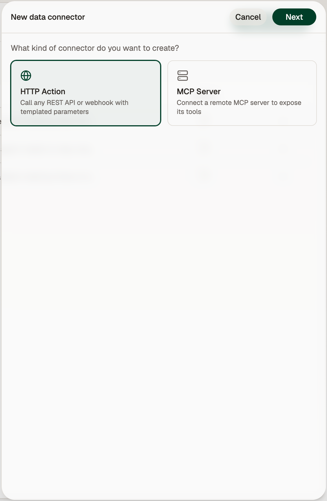
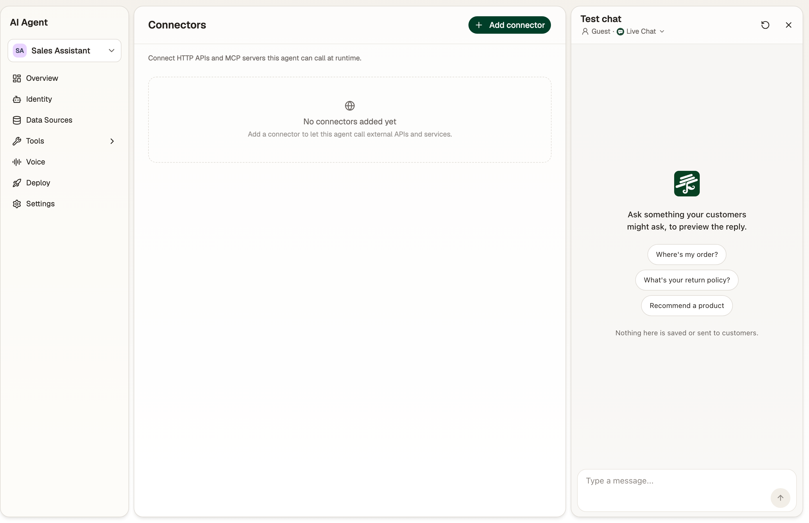

Your AI agent can look things up and take actions in your own systems while it talks to a customer. For example, it can check a booking, a loyalty balance or a warranty. You describe when to use each connector, and the agent calls it when a conversation needs it.

## Before you start

- To create, change and delete connectors, you need the **Owner**, **Admin** or **Supervisor** role.
- For an HTTP action: the endpoint's URL, method and any authentication.
- For an MCP server: its URL and any authentication.

## Create a connector

1. Go to **Settings → Data Connectors** and select **New connector**.
2. Under **What kind of connector do you want to create?**, choose one:
   - **HTTP Action** calls any REST API or webhook with templated parameters.
   - **MCP Server** connects a remote MCP server and gives the agent its tools.

   

3. Enter a **Name**, such as *Order Lookup*.
4. Under **When to use**, tell the agent when to call it. For example: *Use when a user asks about their order status or wants to track a delivery.* The agent decides from this text, so be specific.
5. Fill in the details:
   - **HTTP Action**: choose the **Method**, enter the **URL** and, for methods that send data, the **Body**. Add **Parameters** for the values the agent should fill in, each with a **Name**, **Type** and **Description**, and use them in the URL or body as `{{name}}`. For example, `https://api.example.com/orders/{{orderId}}`.
   - **MCP Server**: enter the **Server URL**, such as `https://mcp.example.com`.
6. Set the **Authentication** and any **Headers (optional)** the service needs.
7. Select **Create connector**.

## Give it to an agent

1. Open **AI Agents** and choose the agent.
2. Go to **Tools → Connectors** and select **Add connector**.
3. Pick the connector, or select **Create new** to make one.

   

The agent can now use it in conversations on every channel it answers.

## Check it works

Open the agent's **Test chat** and ask something that matches **When to use**. The agent calls the connector and answers with what it returned.

:::caution
Connectors run for real in the test chat. If a connector changes something in your system, the change happens.
:::

## Common questions

### The agent never calls my connector. Why?

The agent decides from **When to use**. Make it describe the customer's question plainly, such as *Use when a customer asks how many loyalty points they have.* Check that the connector is **Active** and added to the agent under **Tools → Connectors**.

### What's the difference between Actions and Connectors?

**Actions** are built into Fufa, such as looking up an order in your connected store. Turn them on under **Tools → Actions**. **Connectors** are your own APIs and MCP servers, which you add yourself.

### Can one connector be used by several agents?

Yes. Connectors live in **Settings → Data Connectors**, and you add the same connector to as many agents as you like.

## Related

- [Create an agent](/agents/create-an-agent/)
- [Give an agent a voice](/agents/voice/)
- [Build a custom workflow](/workflows/create-a-workflow/)
