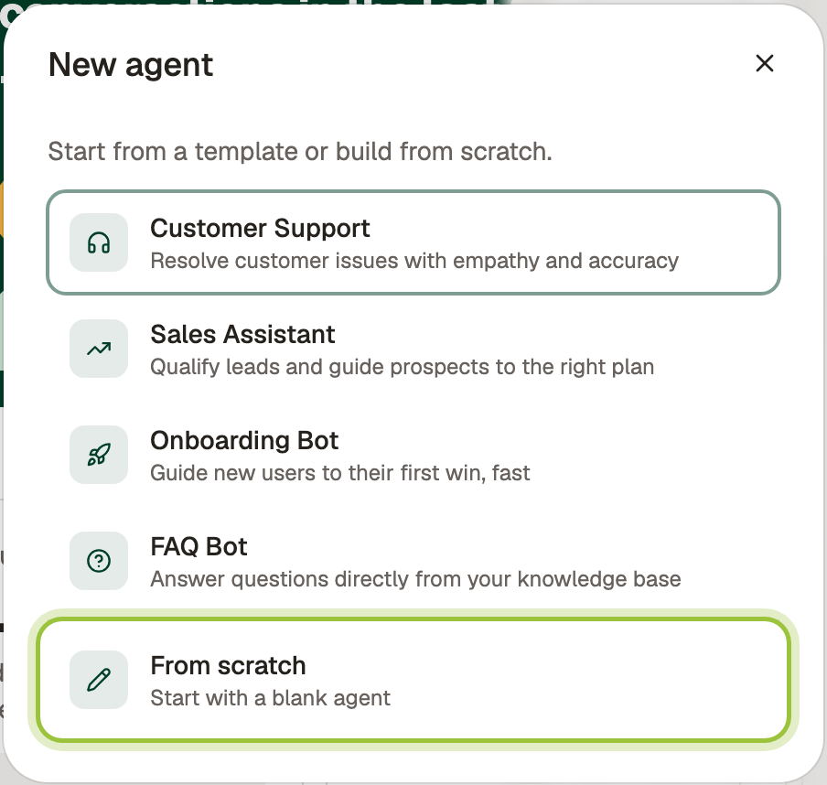
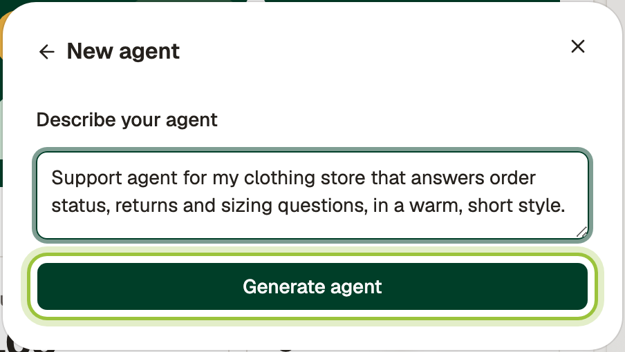
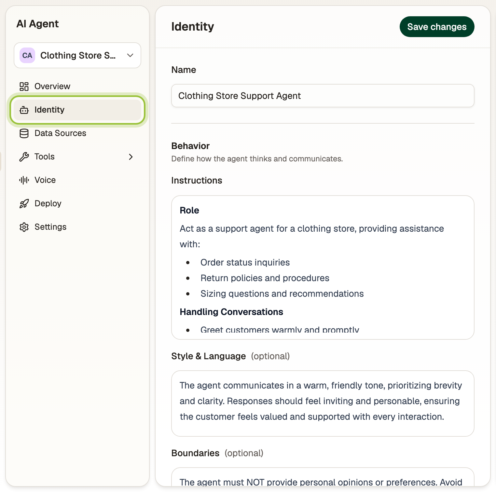
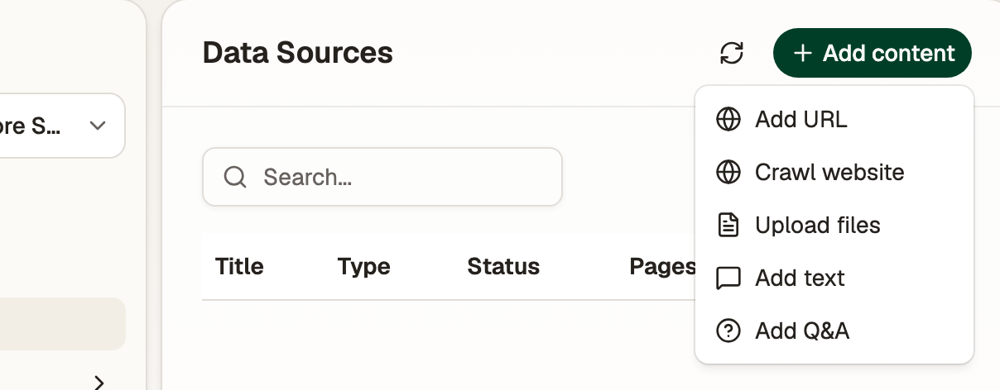
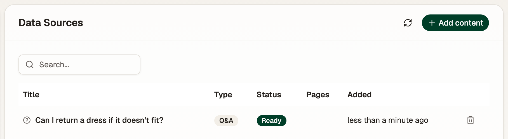
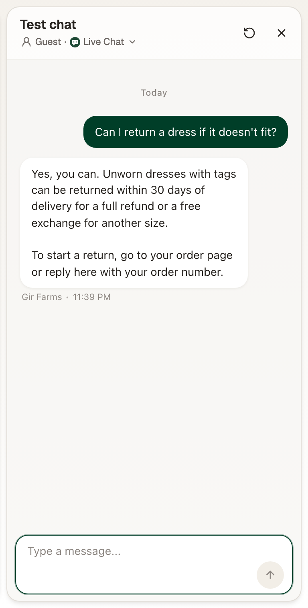
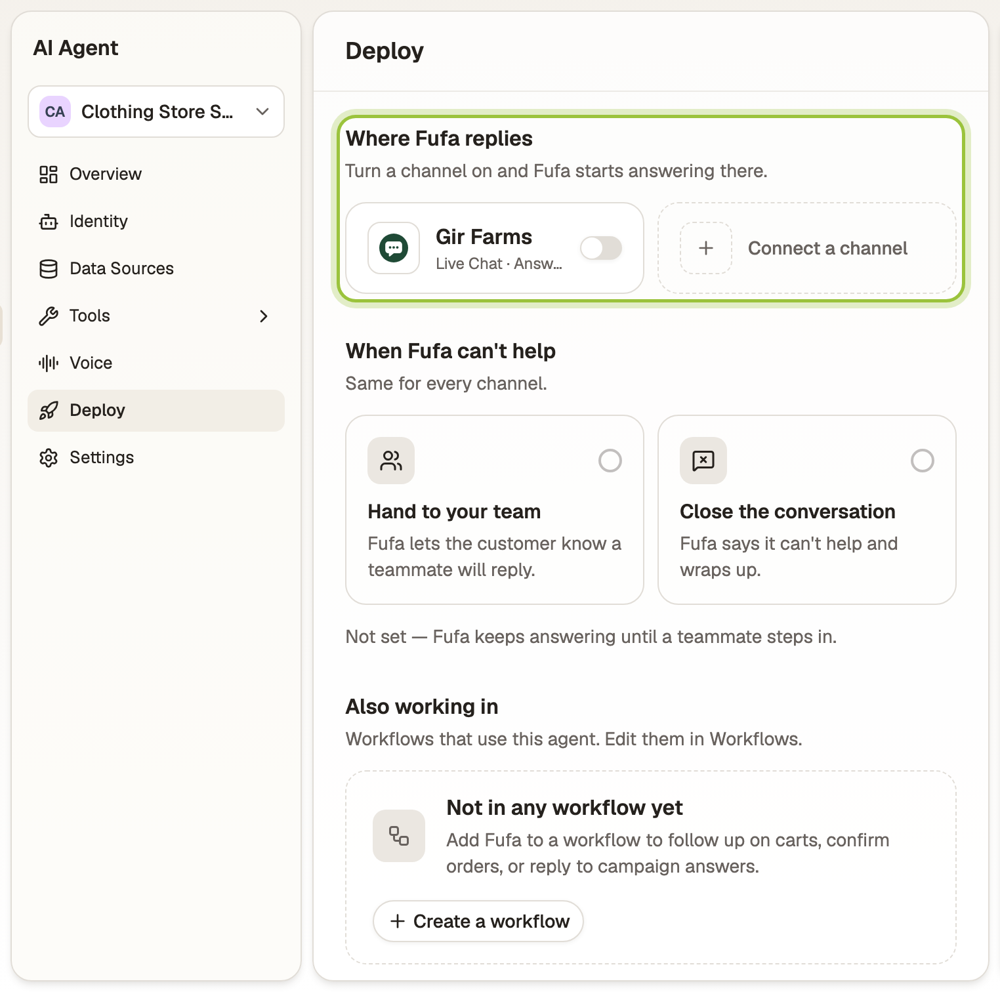

You have an AI agent that answers customers on the channels you choose. It uses your instructions, your knowledge and, if you sell on Shopify, your live catalogue and orders. When it can't help, it hands the conversation to your team.

## Before you start

- You need the **Owner**, **Admin** or **Supervisor** role to set up and change agents.
- At least one connected channel, such as [WhatsApp](/channels/whatsapp/) or [live chat](/channels/live-chat/), before the agent can answer customers.
- Optional but recommended: [Connect Shopify](/commerce/shopify/) first, so the agent can look up products and orders.

## Create it

<video class="fd-clip" src="/clips/agents/create-an-agent.webm" poster="/clips/agents/create-an-agent.jpg" autoplay muted loop playsinline aria-label="Creating an agent: New agent, From scratch, describe the agent, Generate agent."></video>

1. Open **Agents**. Open the agent menu at the top of the agent's sidebar and select **New agent**. On a new workspace, you'll see **Create your first agent** instead.
2. Pick a template, such as **Customer Support** or **Sales Assistant**, or select **From scratch**.

   

3. Under **Describe your agent**, write what it should do in a sentence or two. For example: *Support agent for my clothing store that answers order status, returns and sizing questions, in a warm, short style.* Then select **Generate agent**.

   

Fufa writes the agent's name, instructions, style and boundaries, and opens it on **Identity**.

## Shape how it talks

Open **Identity** and change anything Fufa wrote, then select **Save changes**:

- **Name** is what customers see.
- **Instructions** describe how the agent behaves, its goals and what it helps with.
- **Style & Language** sets the tone, for example *Friendly and concise. Use simple language.*
- **Boundaries** lists what the agent must not do or say, such as approving refunds without checking the policy.

## Teach it your business

Open **Data Sources** and select **Add content**:

- **Add URL** or **Crawl website** to read your site's pages, such as FAQs, shipping and returns.
- **Upload files** for PDFs and documents.
- **Add text** for anything that isn't written down elsewhere.
- **Add Q&A** for exact answers to common questions, such as *What is your return policy?*

Each source shows **Pending** while Fufa reads it, then **Ready**. The agent uses a source only once it's ready.

## Give it things to do

Open **Tools**:

- **Actions** are built-in things the agent can do, such as looking up an order. Turn on the ones it should use.
- **Connectors** let the agent call your own HTTP APIs and MCP servers. Select **Add connector** to add one.

## Test it

The **Test chat** sits beside every agent page. Talk to the agent the way a customer would. Select **Guest** to pick a real contact instead and see answers that use their history and orders. The restart button begins a new test conversation. Nothing in the test chat is sent to customers.

:::caution
Connected apps run for real in the test chat. If the agent creates or changes something through a connector, the change happens in that app.
:::

## Turn it on

Open **Deploy**:

1. Under **Where Fufa replies**, turn on each channel the agent should answer. It starts replying there right away.
2. Under **When Fufa can't help**, choose **Hand to your team** or **Close the conversation**. If you hand over, the agent tells the customer a teammate will reply.

Your team can take over any conversation from the inbox. See [Reply from the inbox](/inbox/reply/#take-over-from-the-ai-agent).

## Check it's working

The agent's **Overview** shows conversations, revenue influenced, and **Questions Fufa couldn't answer**. Select **Add answer** on any of those questions to teach the agent for next time.

## Common questions

### Does the agent replace my team?

No. It takes the first reply and the repetitive questions. When it can't help, it hands over in the inbox, and anyone on your team can take over a conversation at any time.

### How do I stop the agent?

Turn its channels off on the **Deploy** page, or switch off **Agent is active** under **Settings**.

### Can the agent answer phone calls?

Yes. Turn on **Enable voice** on the agent's **Voice** page, choose a voice, language and greeting, then [connect a phone number](/channels/phone/).

### Can I have more than one agent?

Yes. Create an agent per job, for example one for support and one for sales, and turn each one on for different channels.

## Related

- [Connect Shopify](/commerce/shopify/)
- [Reply from the inbox](/inbox/reply/)
- [Add live chat to your website](/channels/live-chat/)
