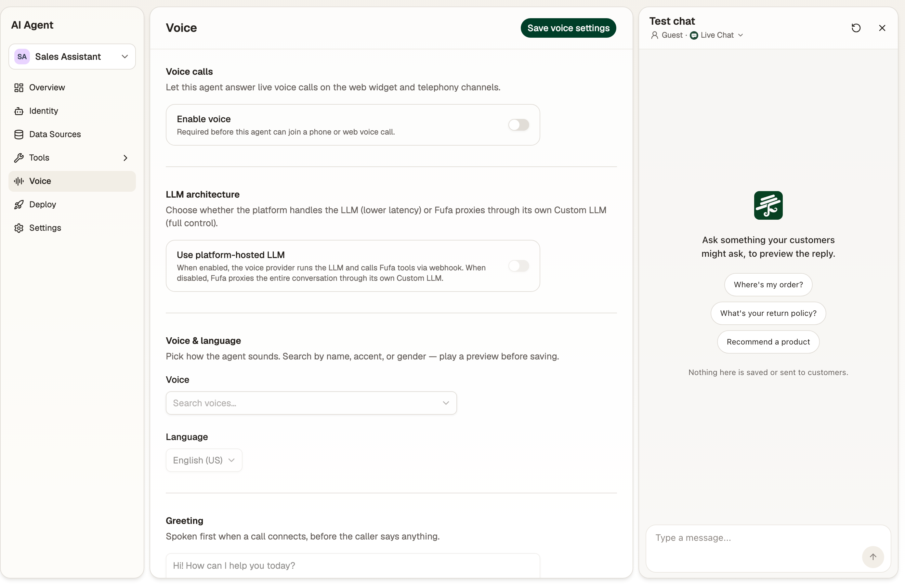

Your AI agent answers phone calls. It speaks in the voice and language you choose, greets callers with your words, and uses the same instructions and knowledge as it does in chat.

## Before you start

- You need the **Owner**, **Admin** or **Supervisor** role to change an agent.
- An agent. See [Create an agent](/agents/create-an-agent/).
- A phone number to connect afterwards. See [Connect a phone number](/channels/phone/).

## Turn on voice

1. Open **AI Agents**, choose the agent, and go to **Voice**.
2. Under **Voice calls**, turn on **Enable voice**.
3. Under **Voice & language**, pick a **Voice**. Search by name, accent or gender, and play a preview to hear it.
4. Choose the **Language**: **English (US)**, **English (UK)**, **Spanish**, **Hindi**, **French** or **German**.
5. Under **Greeting**, write what the agent says first when a call connects, for example *Hi! How can I help you today?*
6. Select **Save voice settings**. Fufa shows **Voice settings saved**.

   

## Connect a phone number

Go to **Settings → Inboxes**, add a **Phone / Voice** channel, and choose this agent as the **Answering agent**. See [Connect a phone number](/channels/phone/).

## Check it works

Call your connected number from another phone. The agent answers with your greeting, in the voice you chose.

## Common questions

### Does the voice agent know the same things as the chat agent?

Yes. It's the same agent, with the same instructions, **Data Sources** and tools. Only how it speaks is set on the **Voice** page.

### Why isn't my agent in the Answering agent list?

Voice isn't turned on for it yet. Open the agent's **Voice** page, turn on **Enable voice**, and select **Save voice settings**.

### What does LLM architecture mean?

It's a technical setting for how the voice call is processed. Leave it as it is unless the Fufa team has asked you to change it.

## Related

- [Connect a phone number](/channels/phone/)
- [Create an agent](/agents/create-an-agent/)
- [Connect your own APIs to an agent](/agents/connectors/)
