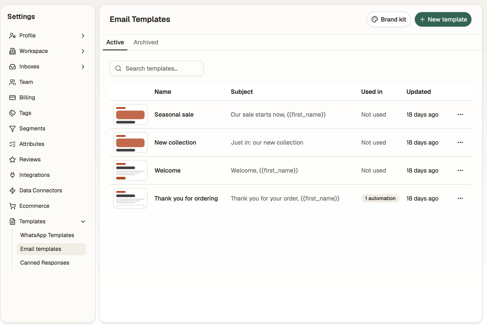
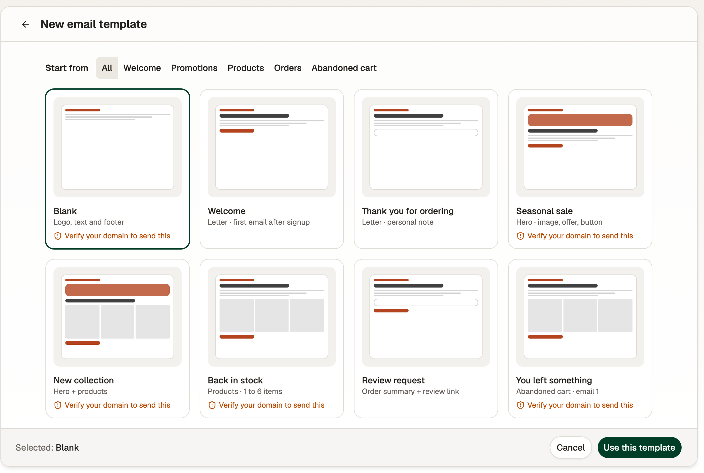

You have branded emails, such as a welcome, a seasonal sale or an abandoned cart reminder, built from ready-made blocks. You send them from an email conversation in the inbox, or automatically from a [workflow](/workflows/how-workflows-run/).

## Before you start

- To create and edit email templates, you need the **Owner**, **Admin** or **Supervisor** role. Every role can see them.
- An [email channel](/channels/email/) to send from.
- Your [brand kit](/workspace/settings/#set-up-your-brand-kit) filled in. Every template takes its logo, colours, font and footer from it.
- For promotional emails, your own sending domain, set up on your email channel in **Settings → Inboxes**.

## Start a template

1. Go to **Settings → Templates → Email templates** and select **New template**.

   

2. Under **Start from**, choose a design. Filter by **Welcome**, **Promotions**, **Products**, **Orders** or **Abandoned cart**. For example, **Seasonal sale**, **Back in stock**, **Review request** or **You left something**. Choose **Blank** to start with just your logo, text and footer.
3. Select **Use this template**.

   

Designs marked **Verify your domain to send this** are promotional. They need your own sending domain before you can send them.

## Edit the content

1. Enter a **Template name** your team will recognise.
2. Write the **Subject**, and optional **Preview text**, the line mail apps show after the subject.
3. Under **Content**, change each block or add new ones: **Heading**, **Text**, **Image**, **Button**, **Products**, **Order summary**, **Discount code**, **Divider** and **Spacer**.
   - In **Products**, choose what to **Show**: **Products you pick**, **A collection**, **Bestsellers**, **The contact's cart** or **The contact's order**.
   - In **Discount code**, enter a **Code** you've already created in your store.
4. Type `{{` in a text field to insert a contact's details, such as their first name. Under **Placeholder values**, set what customers see when a value is missing.
5. Select **Save**.

The header and footer come from your brand kit. Every email has an unsubscribe link.

## Preview and test

Switch between **Desktop** and **Mobile**, and use **Preview as** to see the email filled in for a **Sample contact**. Select **Send test to me** to get it in your own inbox.

## Send it

- **From the inbox**: in an email conversation, type `/` in the composer and choose the template.
- **From a workflow**: add a send email step to an automation, such as an abandoned cart flow, and pick the template.

The list shows where each template is **Used in**. Templates in use show how many automations use them.

## Check it works

Select **Send test to me**. The email arrives in your inbox with your logo, colours and footer.

## Common questions

### Why can't I send a promotional template?

Promotional emails need your own sending domain, so they reach inboxes and don't put other stores' email at risk. Set it up on your email channel in **Settings → Inboxes**. Until then, those designs show **Verify your domain to send this**.

### Why does the Products block show nothing?

**The contact's cart** and **The contact's order** only fill in when the email is sent from an automation that starts from a cart or an order. In the editor and in tests, pick a sample contact who has one, or use **Products you pick** instead.

### Can I stop using a template without deleting it?

Yes. Select **Archive** on its row. It moves to the **Archived** tab, and **Restore** brings it back.

## Related

- [Connect email](/channels/email/)
- [Workspace settings and brand kit](/workspace/settings/)
- [How workflows run](/workflows/how-workflows-run/)
