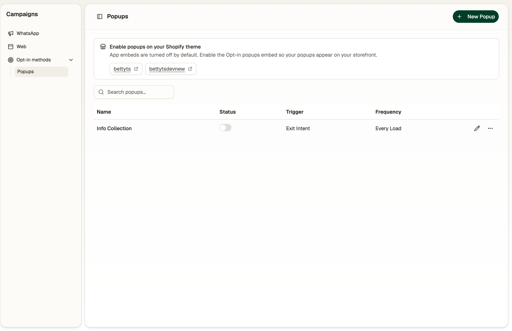
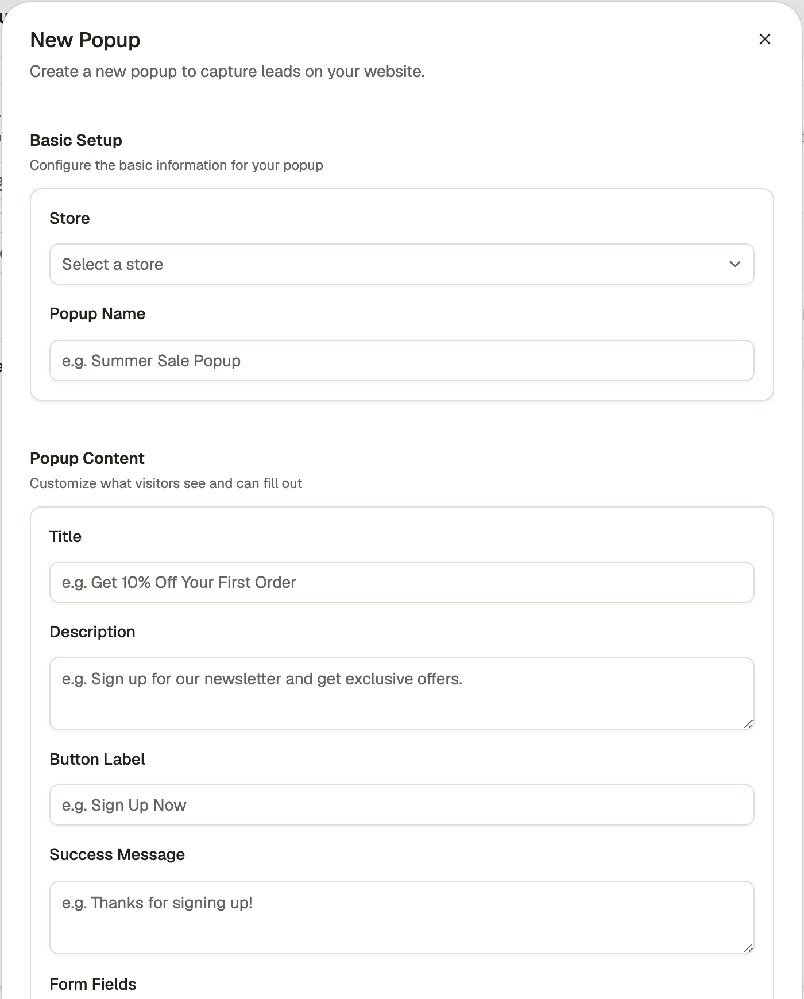
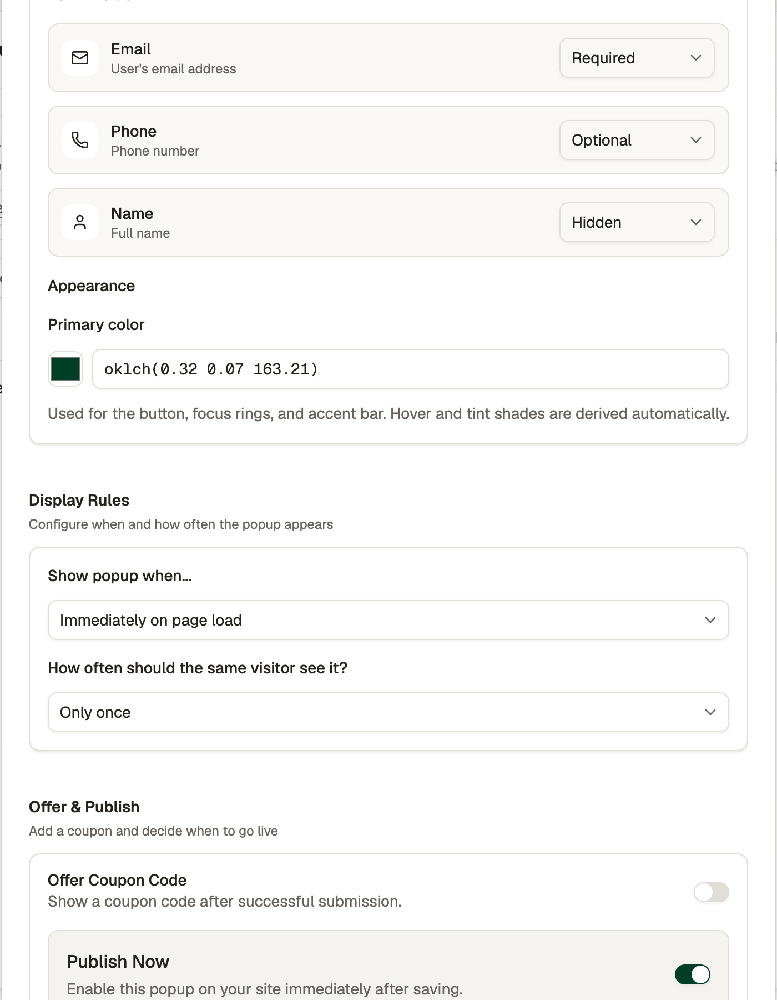

A popup on your Shopify store invites visitors to sign up, for example for 10% off their first order. Everyone who signs up becomes a contact in Fufa and a [subscriber](/contacts/subscribers/), ready for your campaigns.

## Before you start

- You need the **Owner** or **Admin** role.
- A [connected Shopify store](/commerce/shopify/). Popups appear through Fufa's Shopify app.
- Optional: a discount code from Shopify to offer in the popup.

## Turn on popups in your theme

Shopify keeps app embeds off until you turn them on, once per theme.

1. Open **Campaigns → Opt-in methods → Popups**.
2. In **Enable popups on your Shopify theme**, select your store. Shopify's theme editor opens with Fufa's embed selected.
3. Turn on **Opt-in popups** and select **Save** in Shopify.

   

## Create a popup

1. On the **Popups** page, select **New Popup**.
2. Under **Basic Setup**, choose the **Store** and enter a **Popup Name**, such as *Summer Sale Popup*.

   

3. Under **Popup Content**, write the **Title**, **Description**, **Button Label** and **Success Message** visitors see.
4. Under **Form Fields**, set **Email**, **Phone** and **Name** to **Required**, **Optional** or **Hidden**.
5. Under **Appearance**, set the look to match your store.
6. Under **Display Rules**, choose **Show popup when…**: **Immediately on page load**, **When user scrolls down**, **After a time delay**, or **When user tries to leave**. Then choose **How often should the same visitor see it?**: **Only once**, **Every page load** or **Every X days**.
7. Under **Offer & Publish**, optionally add an **Offer Coupon Code**, such as *WELCOME10*, and turn on **Publish Now** to show the popup as soon as you save.

   

8. Select **Create Popup**.

To change a popup later, select **Edit** on its row.

## Check it works

Open your store in a private browser window and trigger the popup, for example by waiting or scrolling. Sign up with a test email. The contact appears in **Contacts → Subscribers**.

## Common questions

### Why isn't my popup showing on my store?

Check three things. The **Opt-in popups** app embed is on in the theme you've published. The popup is published. And your browser hasn't already seen it: with **Only once**, a visitor sees the popup a single time, so test in a private window.

### Do people who sign up get added as subscribers?

Yes. Everyone who submits the popup is added as a contact, or matched to their existing contact, and marked as opted in. They can receive your [WhatsApp campaigns](/campaigns/send-a-campaign/).

### Can I use popups without Shopify?

Not yet. Popups are shown on your storefront through Fufa's Shopify app, so they need a connected Shopify store.

## Related

- [Subscribers](/contacts/subscribers/)
- [Send a WhatsApp campaign](/campaigns/send-a-campaign/)
- [Connect Shopify](/commerce/shopify/)
