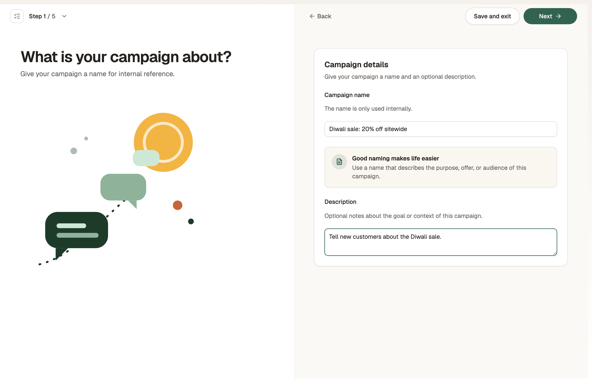
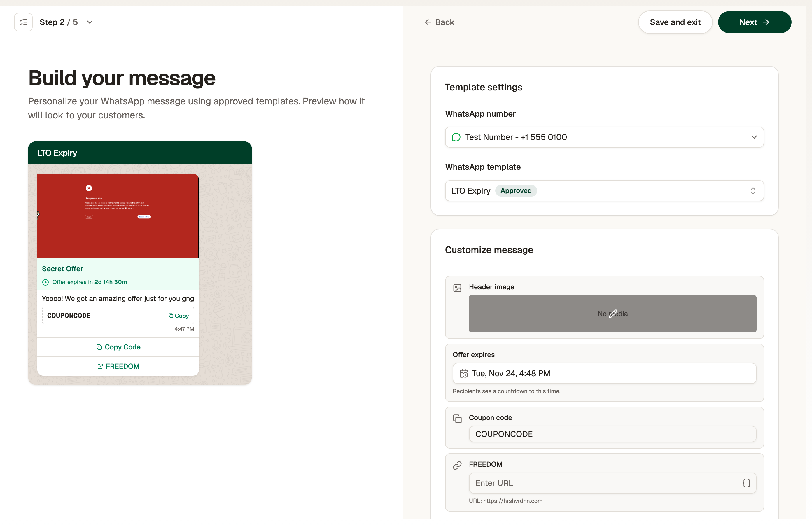
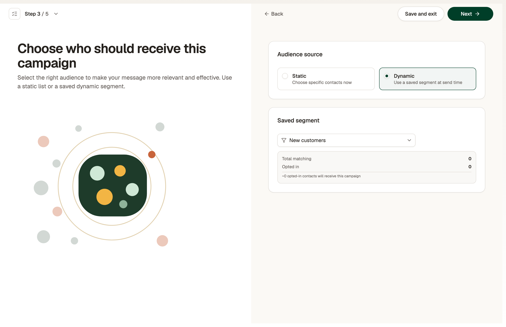
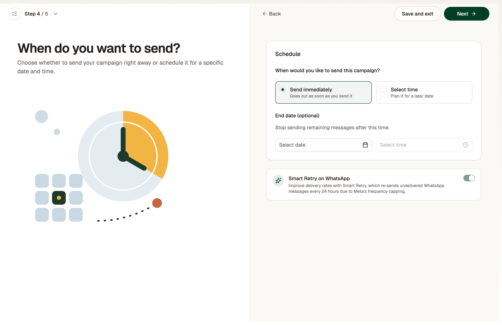
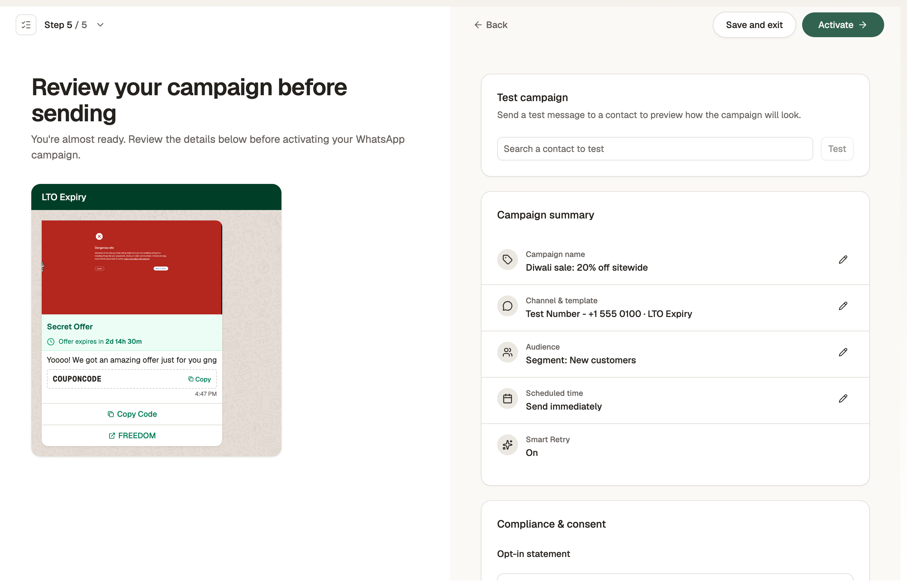
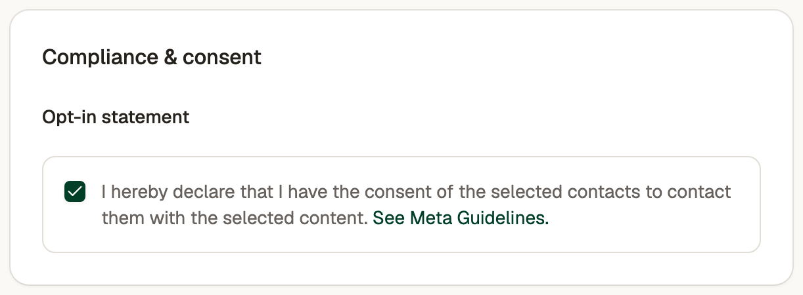

Your opted-in customers get a WhatsApp message from your business number. You see how many were delivered and read, who clicked, and the orders and revenue that came from it. Replies land in your inbox like any other conversation.

## Before you start

- You need the **Owner** or **Admin** role. The **Agent** role can view campaigns but not send them, and the **Supervisor** role doesn't see Campaigns.
- A [connected WhatsApp number](/channels/whatsapp/) with marketing messages turned on.
- An approved [WhatsApp template](/campaigns/whatsapp-templates/).
- Contacts who have [opted in](/contacts/subscribers/). Only they receive campaigns.

## Create the campaign

1. Open **Campaigns**, select **WhatsApp**, then **New campaign**. Fufa creates a draft and walks you through five steps. Select **Next** after each one. To finish later, select **Save and exit** at any step.
2. **Details**: enter a **Campaign name** your team will recognise, and an optional **Description**.

   

3. **Message**: choose the **WhatsApp number** to send from and the **WhatsApp template**. Only approved templates can be sent. Under **Customize message**, fill in what the template needs, such as a header image, the text for each variable, an offer's expiry or a coupon code. The preview shows what customers will see.

   

4. **Audience**: under **Audience source**, choose one:
   - **Static** to choose specific contacts now, then **Add to audience**.
   - **Dynamic** to use a saved [segment](/contacts/segments/), sent to whoever is in it when the campaign goes out. Pick it under **Saved segment**.

   Fufa shows the **Total matching** contacts and how many are **Opted in**.

   

5. **Schedule**: choose **Send immediately**, or **Select time** and set the **Date and time** and **Timezone**. Optionally set an **End date (optional)** to stop sending any remaining messages after that time.

   

## Test and send

1. On **Review**, check the **Campaign summary**. Select the pencil on any line to go back and change it.
2. Under **Test campaign**, search for a contact, such as yourself, and select **Test**.

   

3. Under **Compliance & consent**, tick the **Opt-in statement** to confirm you have your contacts' consent.

   

4. Select **Activate**, then **Send now** or **Schedule** to confirm. To keep it as a draft instead, select **Save and exit**.

**Smart Retry on WhatsApp** is always on. It re-sends undelivered messages every 24 hours, because Meta limits how many marketing messages each person can receive.

## Follow the results

Open the campaign from the list. Its page shows **Sent**, **Delivered**, **Read** and **Clicked**, then the orders and **Revenue** from people who got it. Select a number to see who's in it, including the messages that were undelivered and the numbers that were unreachable.

Under the results, Fufa suggests follow-ups such as **Remind who didn't read** and **Follow up with who clicked**. Each one creates a new draft campaign for that group, for you to review before it sends.

From the campaign's page you can also **Pause** and **Resume** a sending campaign, cancel a scheduled one, or **Duplicate** it.

## Check it works

Send a test to your own number from the **Review** step. It arrives on your phone as a WhatsApp message from your business number.

## Common questions

### Why are fewer people receiving my campaign than are in my segment?

Only opted-in contacts receive campaigns. The **Audience** step shows **Total matching** and **Opted in**. Only the opted-in number is sent. Meta may also hold back messages to people who have had many marketing messages recently, and Smart Retry tries those again every 24 hours.

### Why can't I pick my template?

Only templates Meta has approved can be sent. A new template shows **Waiting on template approval** until Meta reviews it. See [Create a WhatsApp template](/campaigns/whatsapp-templates/).

### What happens when a customer replies to a campaign?

The reply opens a conversation in your inbox, and your AI agent or your team answers it like any other message. Within 24 hours of their reply, you can write freely without a template.

### How is revenue counted?

Fufa counts paid orders from your connected store placed by people within 7 days of receiving the campaign. It shows revenue the campaign influenced, and orders appear on the campaign's page as they come in.

## Related

- [Create a WhatsApp template](/campaigns/whatsapp-templates/)
- [Group contacts into segments](/contacts/segments/)
- [Subscribers](/contacts/subscribers/)
