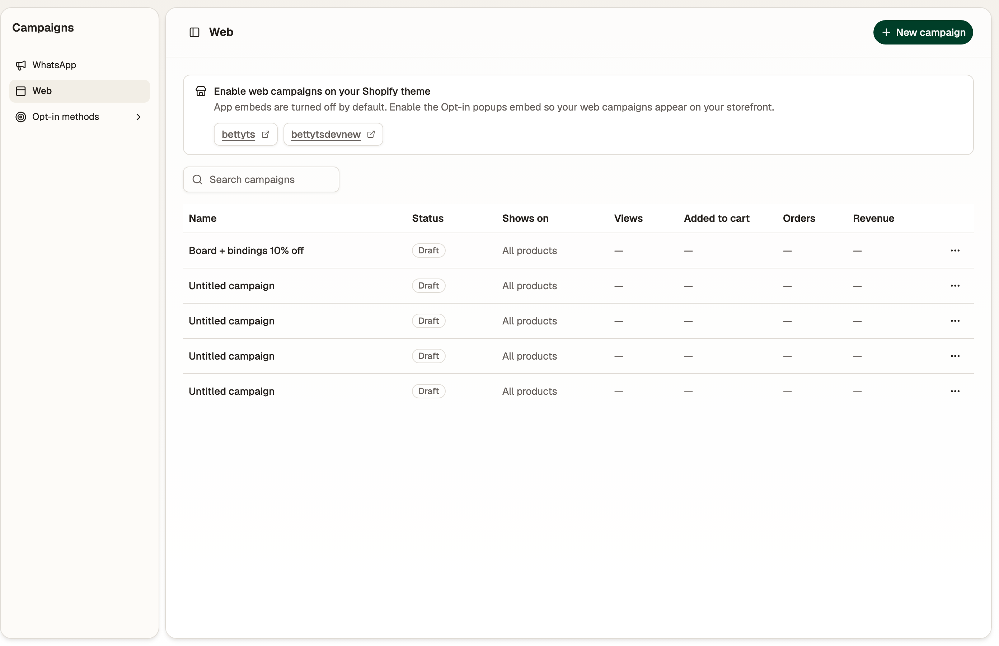
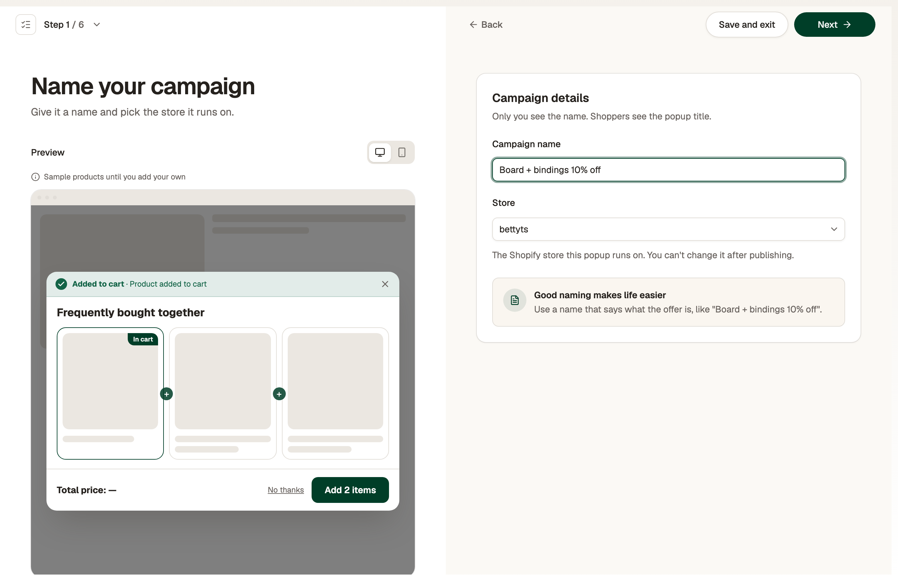
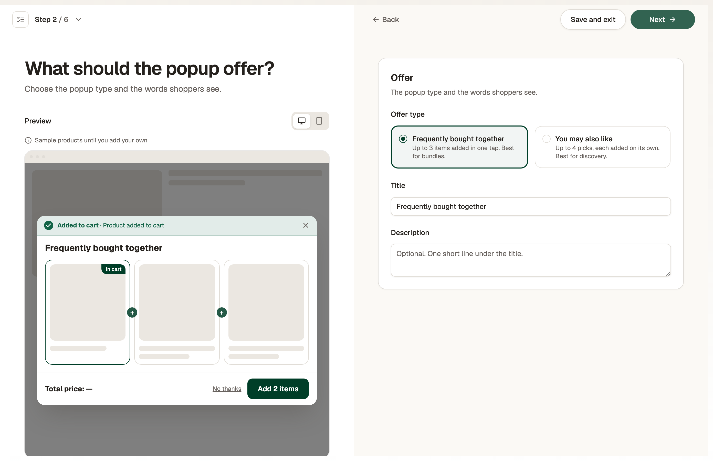
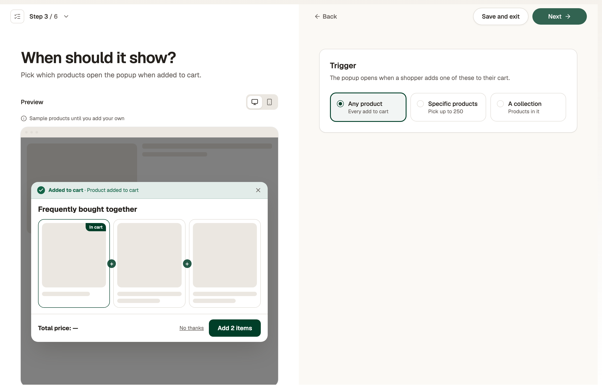
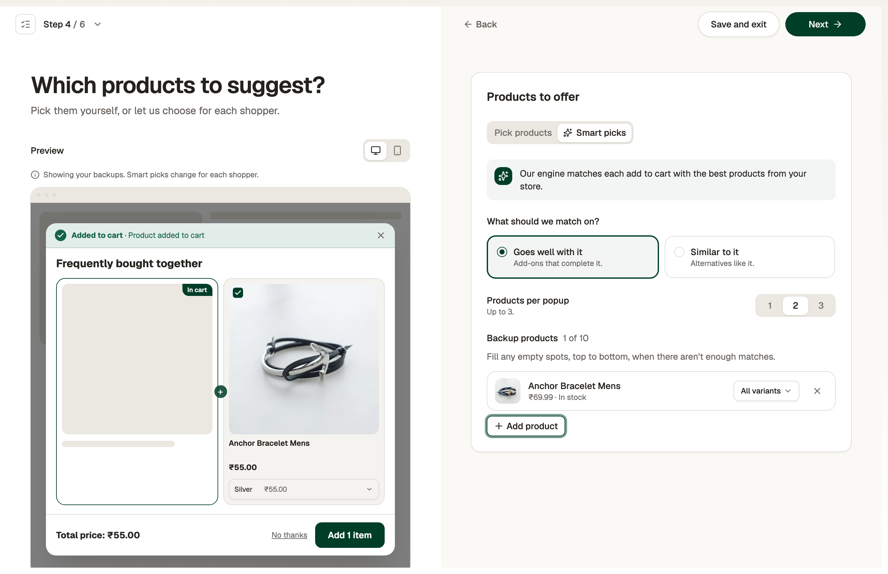
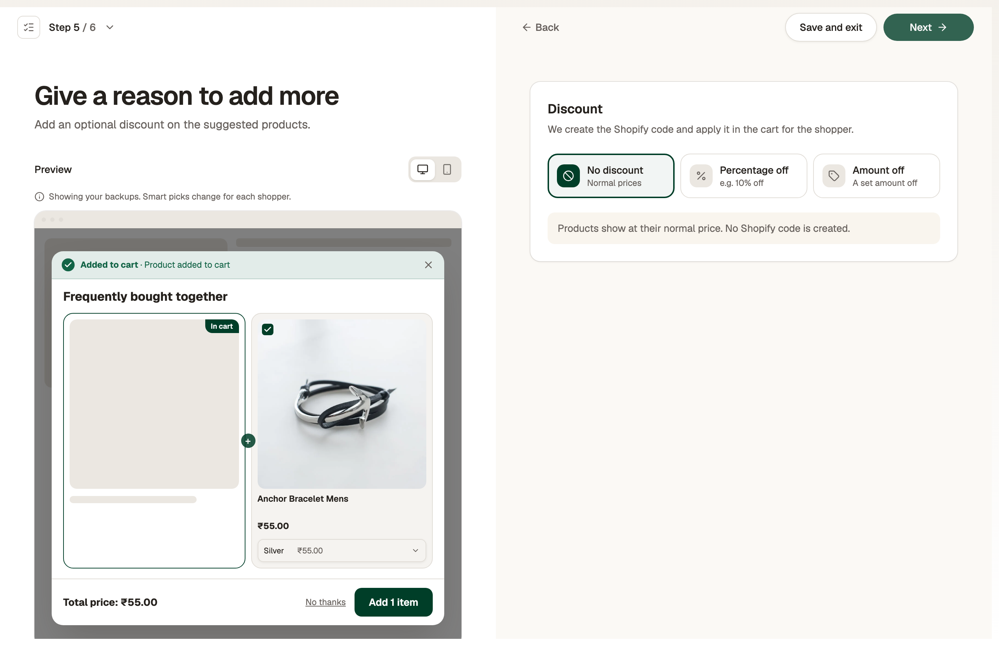
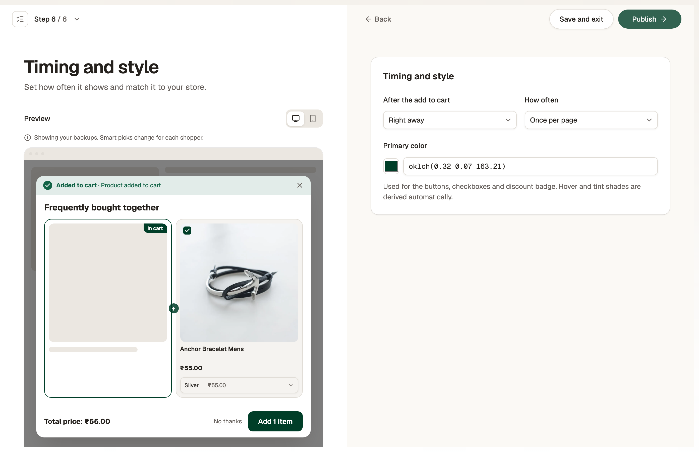

When a shopper adds a product to their cart, a popup on your Shopify store suggests more products, such as items that go with it, with an optional discount. You see how many shoppers saw it, added to cart and ordered, and the revenue it brought in.

## Before you start

- You need the **Owner** or **Admin** role.
- A [connected Shopify store](/commerce/shopify/) with its products synced.
- The **Opt-in popups** app embed turned on in your Shopify theme. Web campaigns use the same embed as [opt-in popups](/campaigns/opt-in-popup/#turn-on-popups-in-your-theme).

## Create a web campaign

1. Open **Campaigns → Web** and select **New campaign**. The steps are **Details**, **Offer**, **Trigger**, **Products**, **Discount** and **Display**. Select **Next** after each one. The **Preview** shows the popup as shoppers will see it, on desktop or mobile.

   

2. **Details**: enter a **Campaign name**, such as *Board + bindings 10% off*, and choose the **Store**. You can't change the store once the campaign is live.

   

3. **Offer**: choose the **Offer type**:
   - **Frequently bought together**: up to 3 items added in one tap. Best for bundles.
   - **You may also like**: up to 4 picks, each added on its own. Best for discovery.

   Then write the **Title** and an optional **Description**.

   

4. **Trigger**: choose which add-to-cart opens the popup: **Any product**, **Specific products** (up to 250), or **A collection**.

   

5. **Products**: choose **Pick products** to choose them yourself, or **Smart picks** to let Fufa match each add-to-cart with the best products from your store. With **Smart picks**, choose **Goes well with it** or **Similar to it**. Products already in the cart are skipped. With **Smart picks**, also add at least one backup product. Fufa uses backups to fill empty spots when there aren't enough matches.

   

6. **Discount**: optionally add a discount on the suggested products. Fufa creates the Shopify discount code and applies it in the shopper's cart.

   

7. **Display**: choose when it shows after the add to cart (**Right away**, **After a delay**, **After scrolling** or **When leaving the page**), **How often** (**Once per page**, **Once per visitor** or **Every few days**), and the **Primary color**.

   

8. Select **Publish**. Fufa shows **Your campaign is live**.

## Follow the results

Open the campaign from the **Web** list. **From view to revenue** shows how many shoppers **Saw the popup**, **Added to cart** and **Ordered**, and the **Revenue**. From the campaign you can **Pause**, **Resume**, or **Edit offer**.

## Check it works

Open your store in a private window and add a trigger product to the cart. The popup appears with your offer.

## Common questions

### Why isn't my web campaign showing?

Check that the **Opt-in popups** app embed is on in your published Shopify theme, the campaign is live and not paused, and the product you added matches its **Trigger**. With **Once per visitor**, a shopper sees it only once, so test in a private window.

### What's the difference between a web campaign and an opt-in popup?

A web campaign sells. It appears after an add to cart and suggests products. An [opt-in popup](/campaigns/opt-in-popup/) collects email and phone sign-ups for your WhatsApp campaigns.

### Do I need to create the discount code in Shopify?

No. Fufa creates the code in your Shopify store and applies it in the cart for shoppers who take the offer.

## Related

- [Collect opt-ins with a popup](/campaigns/opt-in-popup/)
- [Connect Shopify](/commerce/shopify/)
- [Send a WhatsApp campaign](/campaigns/send-a-campaign/)
