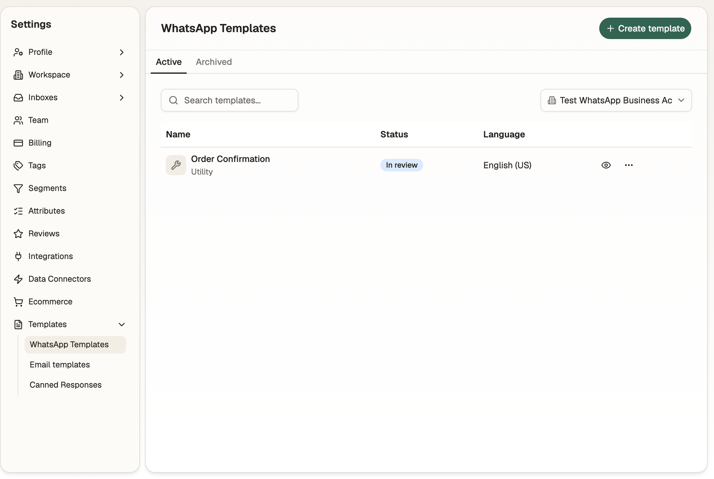
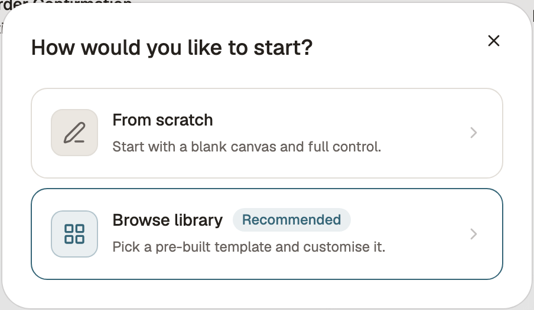

You have a WhatsApp template that Meta has approved. You use it to send campaigns, and to message a customer when it's been more than 24 hours since they last wrote to you.

## Before you start

- You need the **Owner**, **Admin** or **Supervisor** role. Every role can see templates and send approved ones from the inbox.
- A [connected WhatsApp number](/channels/whatsapp/).

## Start a template

1. Go to **Settings → Templates → WhatsApp Templates** and select **Create template**.

   

2. Choose how to start:
   - **Browse library** to pick a ready-made template by industry and customise it. Select the one you want, then **New template**.
   - **From scratch** to start blank.

   

3. Under **Create your template**, choose the **Business Account**, enter a **Template Name** such as *Order Confirmation*, and pick the **Language**.
4. Choose the **Category**:
   - **Marketing** for promotions, offers and product launches. Then pick the **Template type**: **Standard** for a single message, **Carousel** for up to 10 cards, or **Limited-Time Offer** for a coupon with a timer.
   - **Utility** for order updates and account alerts.
   - **Authentication** for verification codes.
5. Select **Continue**.

## Design the message

1. Optionally add a **Header**: **Headline**, **Image**, **Video** or **PDF**.
2. Write the **Message Body**. Type `{{` to insert a contact attribute, such as the customer's first name.
3. Optionally **Add footer**, a short line under the message.
4. Optionally add buttons, such as a link to your website, a phone number, or **Copy Code** for a discount code. Turn on **Track clicks** on a link button to see who tapped it in your campaign results.

The preview on the right shows how the message will look on a phone.

## Submit it for approval

Select **Submit for Review**. The template shows **In review** until Meta decides, which usually takes from a few minutes to a day. It then shows **Approved** or **Rejected**.

To finish it later, select **Save as Draft** instead.

## Check it works

The template shows **Approved** in the list. Start a [campaign](/campaigns/send-a-campaign/) or open a WhatsApp conversation and type `/`. The template is there to choose.

## Common questions

### Why was my template rejected?

Meta rejects templates that break its rules, for example a marketing message submitted as **Utility**, or variables at the very start or end of the message. Edit the template to fix the problem and submit it again.

### What do Paused and Disabled mean?

Meta pauses a template when many customers block or report the messages sent with it, and disables it if that keeps happening. Rewrite the message to be more useful to customers, and submit a new template.

### Can I change an approved template?

You can't change an approved template's category, name or language. To send something different, select **Duplicate** on its row, change the copy, and submit the copy for review.

### How do I hide old templates?

Select **Archive** on the template's row. It moves to the **Archived** tab and no longer appears when you pick a template.

## Related

- [Send a WhatsApp campaign](/campaigns/send-a-campaign/)
- [Connect WhatsApp](/channels/whatsapp/)
- [Save canned responses](/inbox/canned-responses/)
