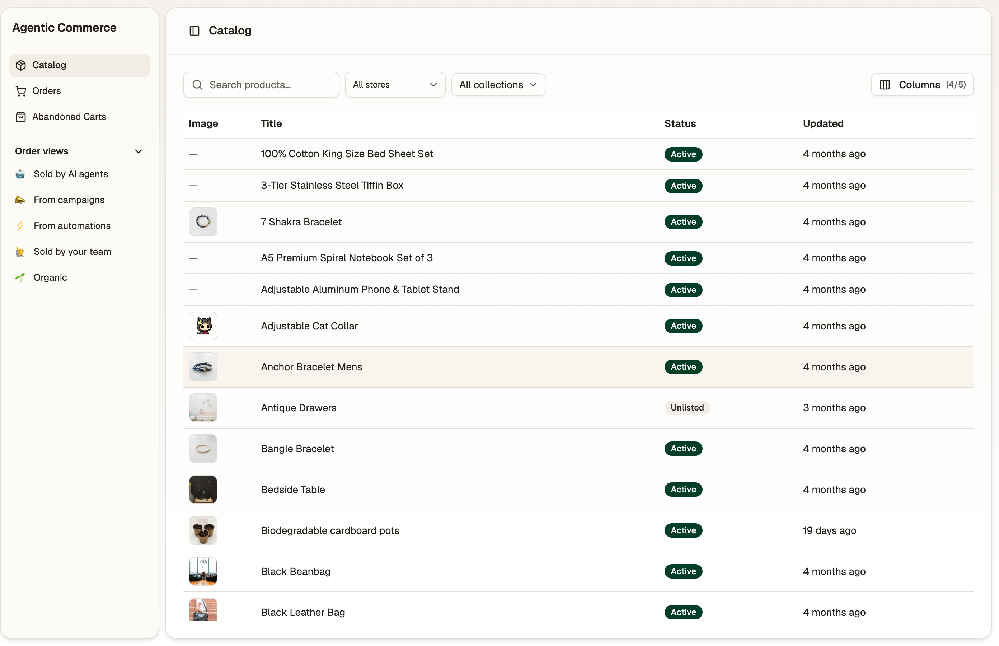
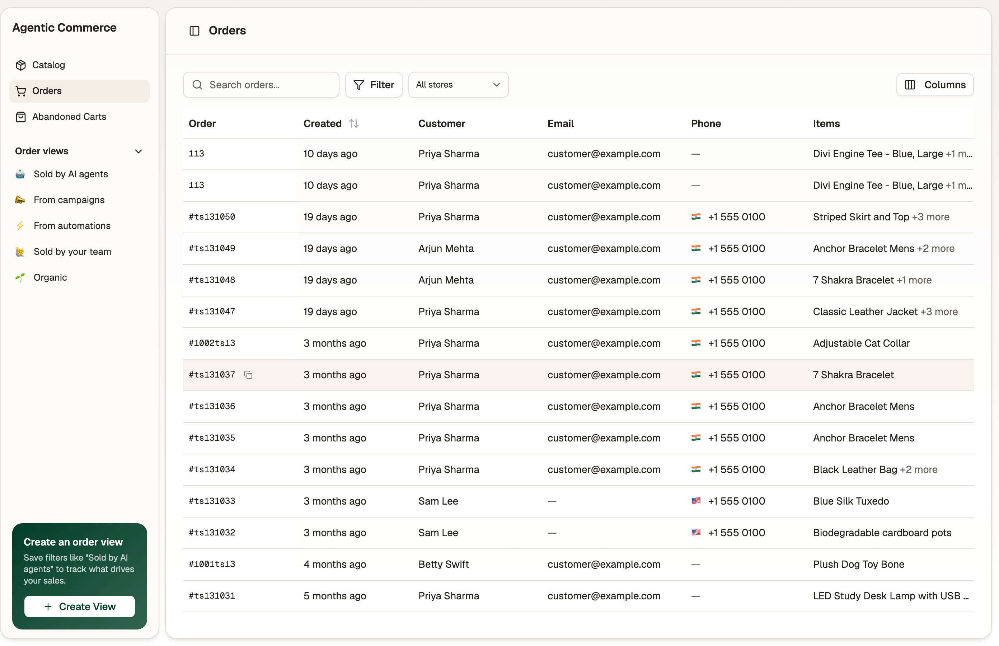
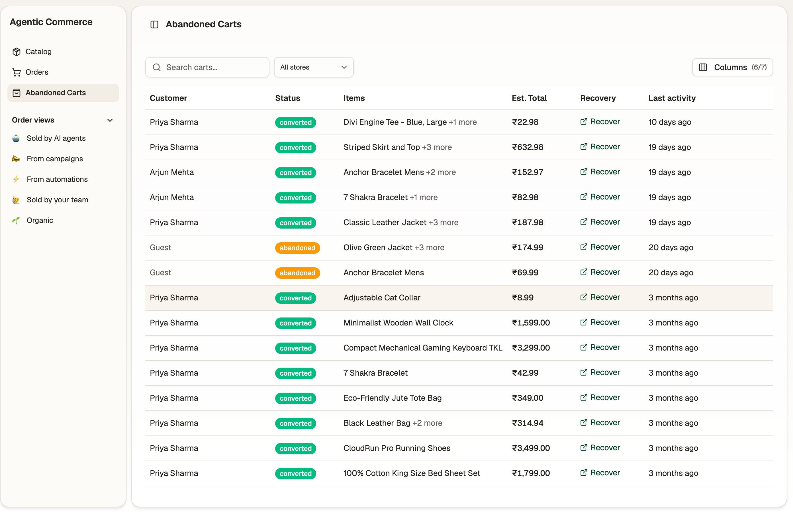

You see your store's products, orders and abandoned carts in Fufa, next to your conversations. Each order shows what brought it in, such as a campaign, a workflow, an AI agent or a teammate.

## Before you start

- A connected store: [Shopify](/commerce/shopify/), [WooCommerce](/commerce/woocommerce/) or [Magento](/commerce/magento/).
- Every role can see Commerce. Products, orders and carts are read-only in Fufa. Change them in your store.

## Browse the catalog

Open **Commerce → Catalog**. Each product shows its image, **Title**, **Status**, **Tags** and when it was **Updated**. Search, or filter by collection with **All collections**. Select a product to see its variants and when it was **Last synced**.

AI agents use this catalog to recommend products and answer questions about price and stock.

## Look up orders

Open **Commerce → Orders**. Each order shows the **Customer**, **Items**, **Total**, **Payment** and **Fulfillment** status, and **Delivery** tracking where your store provides it. If you have more than one store, choose one under **All stores**.

The **Attributed to** column shows what brought the order in: a **Campaign**, a **Workflow**, an **Agent** or a **Team member**. Select an order to see its pricing, items and delivery.

## Follow up on abandoned carts

Open **Commerce → Abandoned Carts**. Each cart shows the **Customer**, or **Guest** if they weren't signed in, its **Items**, **Est. Total**, **Last activity** and when it **Expires**. **Recovery** links to the checkout where the customer left off.

To win carts back automatically, turn on [**Abandoned cart recovery**](/workflows/automations/) on WhatsApp or **Abandoned cart, 3 emails**.

## Check it works

Place a test order in your store. It appears in **Commerce → Orders** within a minute.

## Common questions

### Why don't I see Commerce in the sidebar?

Commerce appears only in workspaces set up for an online store. If your workspace is for another kind of business, it doesn't have Commerce or **Settings → Ecommerce**.

### How does Fufa decide what an order is attributed to?

An order is credited when the customer placed it within 7 days of a campaign, workflow, AI agent or teammate messaging them. It shows that the message influenced the order, not that it was the only reason.

### Can I edit a product or an order in Fufa?

No. Fufa keeps a synced copy for your agents and your team. Change products and orders in your store, and Fufa picks up the change.

## Related

- [Connect Shopify](/commerce/shopify/)
- [Turn on pre-built automations](/workflows/automations/)
- [Build reports and dashboards](/reports/reports-and-dashboards/)
