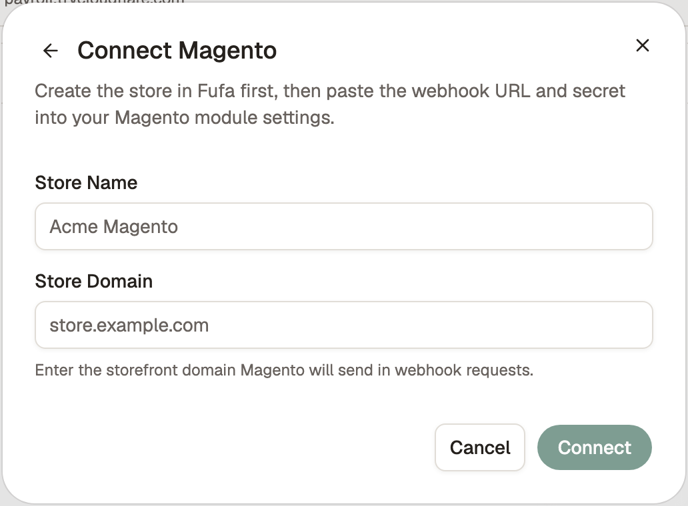

Your Magento store is connected to Fufa. Orders and products flow in, so your AI agents and your team can look up orders and recommend products in conversations.

## Before you start

- You need the **Owner** or **Admin** role in the Fufa workspace.
- Admin access to your Magento store, and someone who can install a Magento module.
- The `Fufa/Webhook` Magento module.

## Add the store in Fufa

1. Go to **Settings → Ecommerce**.
2. Choose **Magento**. If you already have a store connected, select **Add store** first.
3. Enter a **Store Name**, such as *Acme Magento*, and your **Store Domain**, such as `store.example.com`.
4. Select **Connect**. Fufa shows **Magento store created. Copy the webhook details into Magento admin.** with a **Webhook URL** and a **Webhook Secret**.

   

## Install the webhook module

1. Install the `Fufa/Webhook` module in Magento.
2. Enable the module in Magento admin.
3. Paste the **Webhook URL** and **Webhook Secret** from Fufa into the module's configuration.

Magento now sends new orders and changes to Fufa.

## Activate the integration in Magento

Open the store in **Settings → Ecommerce**. Under **Connection URLs** it shows a **Callback URL** and an **Identity Link URL**. Then in Magento admin:

1. Go to **System → Extensions → Integrations**.
2. Click **Add New Integration** in the top right.
3. On the **Integration Info** tab, set **Name** to **Fufa AI**, then paste the **Callback URL** and **Identity Link URL**.
4. Switch to the **API** tab and grant access to both **View Orders** (under **Sales**) and **Catalog**.
5. Click **Save**. Magento asks for your admin password.
6. Back on the Integrations list, click **Activate**.

The store page in Fufa shows **Activated**.

## Check it works

Place a test order in your Magento store. It appears in **Commerce → Orders** in Fufa, and your products are in **Commerce → Catalog**.

## Common questions

### The store page says Not Authenticated. What now?

The Magento integration hasn't been activated yet. In Magento admin, go to **System → Extensions → Integrations** and select **Activate** on the **Fufa AI** integration.

### Why aren't new orders arriving?

Check the `Fufa/Webhook` module is enabled in Magento, and that its configuration has the exact **Webhook URL** and **Webhook Secret** from the store page in Fufa.

## Related

- [Connect Shopify](/commerce/shopify/)
- [Connect WooCommerce](/commerce/woocommerce/)
- [Catalog, orders and carts](/commerce/catalog/)
