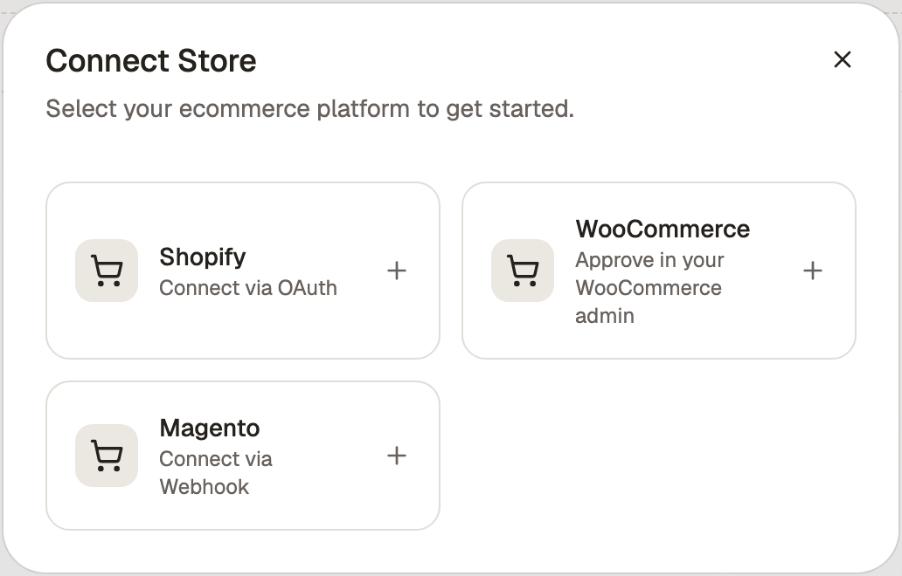

Your Shopify store is connected to Fufa. Fufa imports your catalogue and orders and keeps them in sync, so your team and your AI agents see the same products, stock and order status as your store.

## Before you start

- You need the **Owner** or **Admin** role in the Fufa workspace.
- You need to be able to install apps on the Shopify store, as the store owner or as a staff member with app permissions.

## Connect from Fufa

1. Go to **Settings → Ecommerce**. If you already have a store connected, select **Add store**.
2. Choose **Shopify**.

   

3. Fufa opens the Fufa AI app in the Shopify App Store in a new tab. Install it on your store and approve the permissions Shopify asks for.
4. Shopify sends you back to Fufa, signed in, with your store connected.

New workspaces can also connect Shopify in the setup thread at the top of the inbox. See [Create a workspace](/start/create-a-workspace/).

## What Fufa imports

Right after you connect, Fufa imports your products, collections and orders. A large catalogue can take a few minutes. After that, changes in Shopify flow into Fufa as they happen.

With the store connected:

- AI agents answer product questions from your catalogue, recommend items, and look up a customer's orders.
- Your team sees a customer's orders next to their conversation.
- You can follow up on abandoned carts and confirm cash-on-delivery orders with workflows.

## Show the chat on your storefront

Shopify keeps app embeds off until you turn them on. To show Fufa's chat on your store:

1. In Shopify, open **Online Store → Themes → Customize**.
2. Open **App embeds**, turn on Fufa's **Chat widget** embed, and select **Save**.

The live chat page explains the chat's own settings. See [Add live chat to your website](/channels/live-chat/).

## Common questions

### What does Fufa ask Shopify for permission to do?

Fufa reads your products, orders, customers, draft orders and returns. It can write orders and draft orders, for example to confirm an order or create a checkout link for a customer.

### I installed Fufa from Shopify. Do I still need to connect?

No. Installing from Shopify connects the store and signs you in to your workspace. The store appears under **Settings → Ecommerce**.

### Can I connect more than one store?

Yes. Select **Add store** again for each store. You can point each agent at one store or at **All stores**.

### How do I disconnect a store?

In **Settings → Ecommerce**, select **Disconnect** on the store and confirm. Fufa stops syncing it. To remove the app completely, also uninstall it from your Shopify admin.

## Related

- [Create an agent](/agents/create-an-agent/)
- [Add live chat to your website](/channels/live-chat/)
- [Create a workspace](/start/create-a-workspace/)
