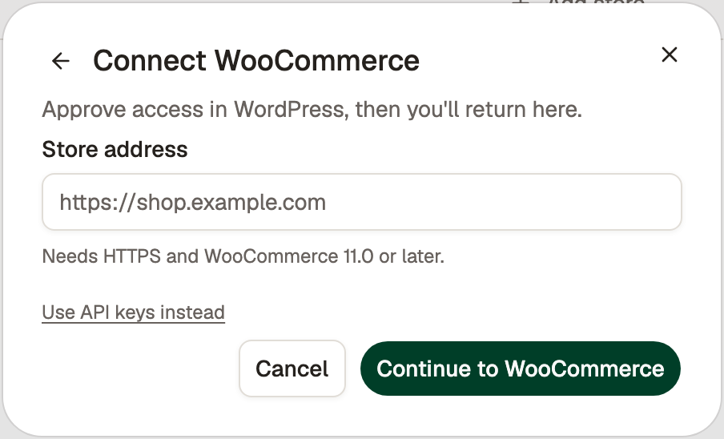

Your WooCommerce store is connected to Fufa. Orders, products and categories are imported and kept up to date, so your AI agents and your team can look up orders and recommend products in conversations.

## Before you start

- You need the **Owner** or **Admin** role in the Fufa workspace.
- Admin access to your WordPress site.
- The Fufa plugin installed and active on your WooCommerce store.
- Your store on HTTPS, with WooCommerce 11.0 or later.

## Connect the store

1. Go to **Settings → Ecommerce**.
2. Choose **WooCommerce**. If you already have a store connected, select **Add store** first.
3. Enter your **Store address**, such as `https://shop.example.com`.
4. Select **Continue to WooCommerce**. WordPress asks you to approve access for Fufa. Approve it, and WordPress sends you back to Fufa.

   

Fufa shows **WooCommerce store connected. Importing orders and products now.**

### Connect with API keys instead

If you can't approve access in WordPress, select **Use API keys instead**:

1. In WordPress, go to **WooCommerce → Settings → Advanced → REST API** and create a key with **Read/Write** permissions.
2. In Fufa, enter the **Consumer key** (`ck_…`) and **Consumer secret** (`cs_…`).
3. Select **Connect store**.

## Check the connection

Open the store in **Settings → Ecommerce**. The store page shows:

- **Import**: how many orders, products and categories were imported, and the **Last order check**.
- **Store notifications**: whether WooCommerce tells Fufa about new orders, order changes and refunds, new customer accounts, and product changes. Each shows **Active**, **Missing** or **Paused**.
- **Fufa plugin**: **Active** when the plugin is installed and talking to Fufa, or **Not detected**.

## Check it works

Open **Commerce → Catalog**. Your WooCommerce products are listed. Place a test order, and it appears in **Commerce → Orders**.

## Common questions

### Why does it say The Fufa plugin isn't installed or active on this store?

Fufa can't reach its plugin on your WordPress site. Make sure the Fufa plugin is installed and activated in WordPress under **Plugins**, then reopen the store page in Fufa.

### Where does shipment tracking come from?

From WooCommerce. If you use a shipment tracking plugin or WooCommerce order fulfilments, Fufa reads tracking from there, so the AI agent can tell customers where their order is.

### How do I disconnect the store?

In **Settings → Ecommerce**, disconnect it from the store's menu and confirm under **Disconnect store?** Fufa stops importing, and your AI agents can no longer look up its orders.

## Related

- [Connect Shopify](/commerce/shopify/)
- [Catalog, orders and carts](/commerce/catalog/)
- [Create an agent](/agents/create-an-agent/)
