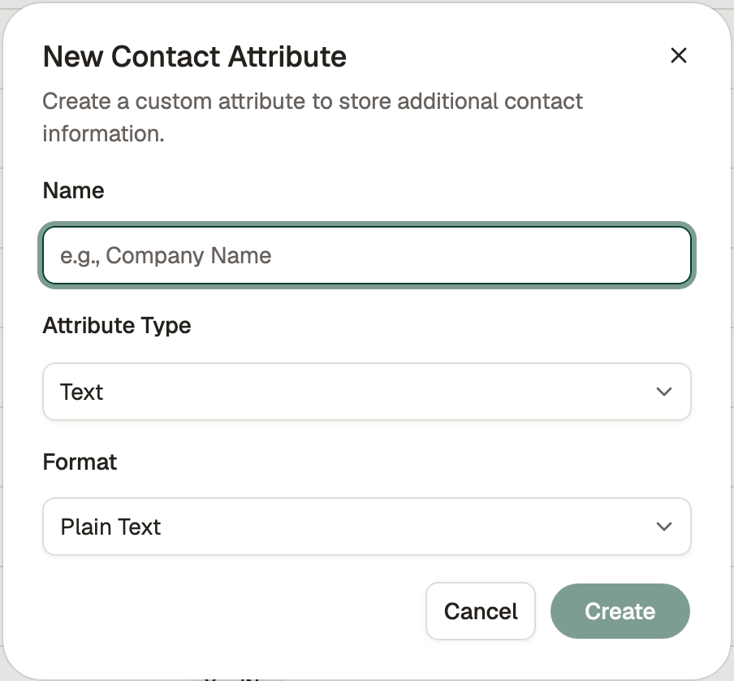

Your contacts carry the details that matter to your business, beyond name, email and phone. You can filter and segment by them, and insert them into canned responses and templates.

## Before you start

- Every role can see attributes and fill in their values on a contact.
- To create, change or delete attributes, you need the **Owner** or **Admin** role.

## Create an attribute

1. Go to **Settings → Attributes**. The page is titled **Contact attributes**.
2. Select **New attribute**.

   

3. Enter a **Name**, such as *Company Name*.
4. Choose the **Attribute Type**: **Text**, **Number**, **Date**, **Yes/No**, **Single Select** or **Multi Select**.
   - For **Text**, choose a **Format**: **Plain Text**, **Email**, **Phone** or **URL**.
   - For **Single Select** and **Multi Select**, add the **Options** to choose from.
5. Select **Create**. Fufa shows **Attribute created successfully**.

Fufa makes the attribute's key from its name, in lowercase with underscores. *Company Name* becomes `company_name`. Use the key in double braces, such as `{{company_name}}`, to insert the value into a [canned response](/inbox/canned-responses/).

Attributes marked **System**, such as name, email and phone, are built in and can't be changed.

## Fill in a value

Open a contact and fill in the attribute in the details panel. You can also map a column to an attribute when you [import contacts](/contacts/contacts/#import-contacts), or select **Create attribute from this column** there.

## Check it works

Open any contact. The new attribute appears in its details, ready to fill in.

## Common questions

### Can I change an attribute's type later?

You can rename an attribute with **Edit**. To change its type, create a new attribute with the type you need, and delete the old one if you no longer use it.

### Can the AI agent see contact attributes?

No. The AI agent knows a customer's name, language and timezone, but not your custom attributes. Attributes are for your team, for filters and segments, and for the text you insert into replies and templates.

### What's the difference between a tag and an attribute?

A tag is a label that's either on a contact or not, such as *VIP*. An attribute holds a value, such as a company name, a birthday or a loyalty tier.

## Related

- [Tag contacts and conversations](/contacts/tags/)
- [Group contacts into segments](/contacts/segments/)
- [Save canned responses](/inbox/canned-responses/)
