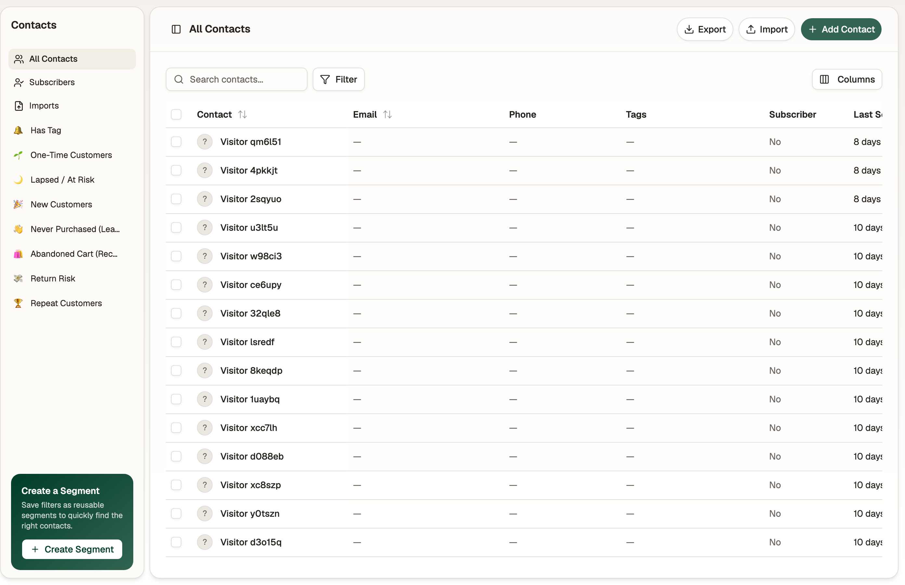
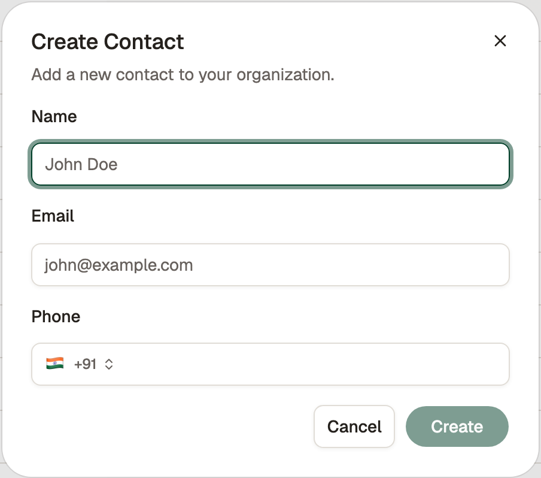
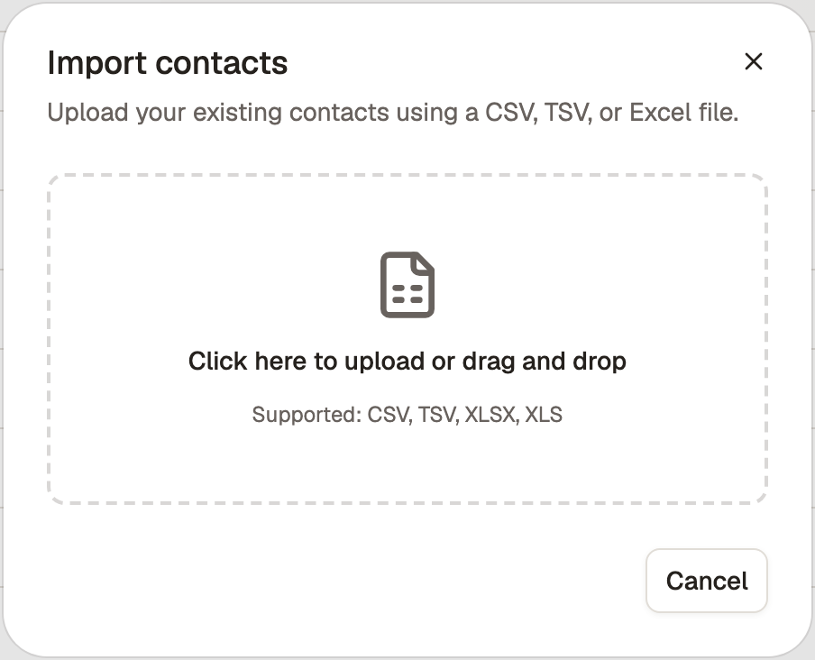

Every customer who writes to you on any channel becomes a contact in Fufa, with their conversations, tags and details in one place. You can also add contacts yourself, import your existing list, merge duplicates and export everyone.

In a store workspace, this section is called **Customers**. Everything on this page works the same way.

## Before you start

- Every role can view, add and edit contacts. Only **Owner** and **Admin** can delete them.
- To import, a CSV, TSV or Excel file with an email or phone column for each contact.

## Find a contact

Open **Contacts** and select **All Contacts**. Search the list, or use **Filter** to narrow it by tag, attribute or opt-in. Select a contact to see their details, tags and conversations in the side panel.

## Add a contact

1. Select **Add Contact**.
2. Enter a **Name**, and an **Email** or a **Phone** number. One of the two is required.
3. Select **Create**.

   

## Import contacts

1. Select **Import**.

   

2. Upload a `.csv`, `.tsv`, `.xlsx` or `.xls` file of up to 10 MB and 50,000 rows, then check the preview and select **Continue**.
3. Under **Map fields**, choose what each **File column** **Maps to**: a contact field, an existing attribute, **Create attribute from this column**, or **Do not import**. Map at least one email or phone column.
4. If some phone numbers have no country code, choose a **Default country** for them. Numbers without a country code are skipped otherwise.
5. Optionally, add **Tags** to every imported contact.
6. Select **Start import**.

Fufa shows **Import complete** when it's done. To see every import, select **Imports** in the sidebar. If rows were skipped, download them from the import to fix and import again. Skipped rows are kept for 30 days.

## Merge duplicates

When two contacts are the same person, for example one from WhatsApp and one from email:

1. Select both contacts in the list.
2. Choose **Merge**.
3. In **Merge contacts**, choose which contact to keep and select **Merge contacts**.

Fufa keeps one contact and moves the other's conversations, orders, tags and details to it. The other contact is deleted. Fufa also flags likely duplicates on a contact, so you can merge them or select **Dismiss**.

## Export contacts

Select **Export**. Fufa downloads the contacts in the current list, including any search or filter you've applied.

## Check it works

Search for a contact you added or imported. They appear in **All Contacts**, with the details you entered.

## Common questions

### Where do contacts come from?

Anyone who messages you on a connected channel becomes a contact automatically. You can also add them yourself, import them, or collect them with an [opt-in popup](/campaigns/opt-in-popup/).

### Why were some rows skipped in my import?

Rows are skipped when they have neither a valid email nor a phone number, or when a phone number has no country code and no **Default country** was chosen. Open the import under **Imports** to download the skipped rows, fix them, and import that file again.

### Does importing contacts subscribe them to marketing messages?

No. Imported contacts aren't opted in. To mark contacts who have agreed to receive marketing, select them and choose **Mark as Subscriber**. See [Subscribers](/contacts/subscribers/).

### What happens to conversations when I merge two contacts?

They're kept. Both contacts' conversations, orders, tags and details end up on the contact you keep.

## Related

- [Tag contacts and conversations](/contacts/tags/)
- [Add contact attributes](/contacts/attributes/)
- [Group contacts into segments](/contacts/segments/)
