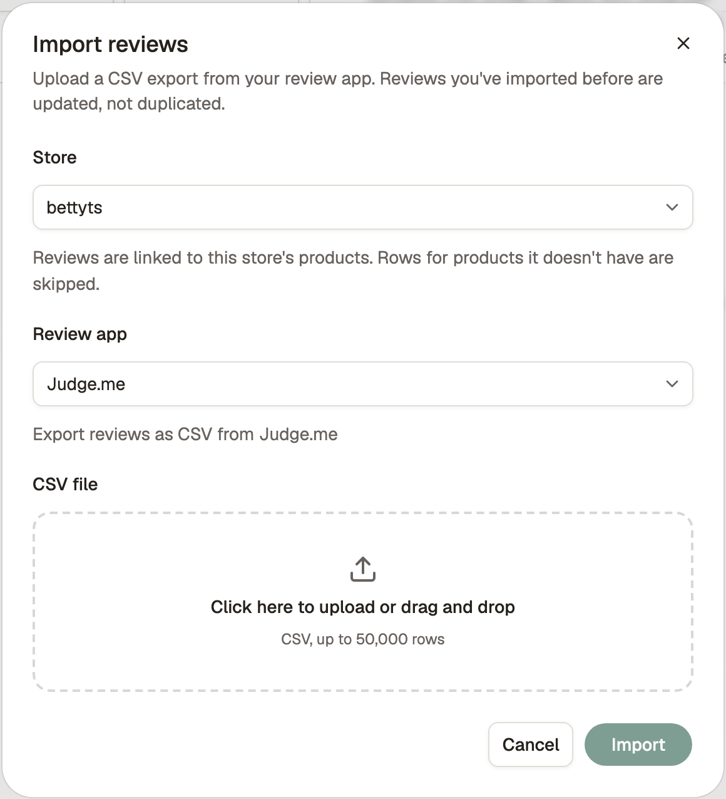
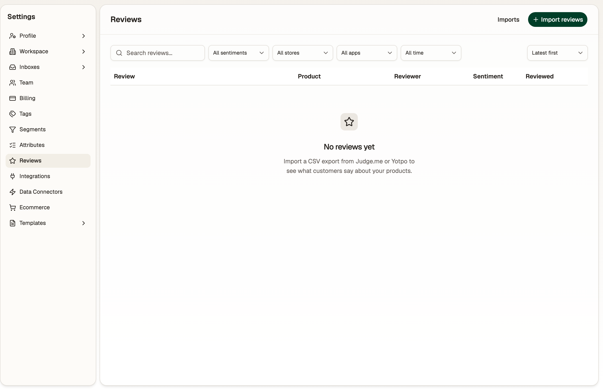

Your product reviews from Judge.me or Yotpo are in Fufa, linked to your products and to the customers who wrote them. Each review is tagged **Positive**, **Neutral** or **Negative**, so you can find unhappy customers quickly.

## Before you start

- Every role can see reviews. To import them, you need a role that can add contacts, which is every role.
- A store connected under **Settings → Ecommerce**, such as [Shopify](/commerce/shopify/). Reviews are matched to that store's products.
- A CSV export of your reviews from Judge.me or Yotpo, up to 50,000 rows.

## Import reviews

1. Go to **Settings → Reviews** and select **Import reviews**.

   

2. Under **Store**, choose the store the reviews belong to.
3. Under **Review app**, choose **Judge.me** or **Yotpo**.
4. Under **CSV file**, upload the export.
5. Select **Import**. Fufa shows **Import started**.

Rows for products the store doesn't have are skipped. To follow the import, select **Imports** at the top of the page.

## Read your reviews

The **Reviews** page lists every review with its product, rating and reviewer. Search them, or select **Filters** to show only one **Sentiment** or **Review app**. Select a review to see its **Review details**.

Fufa sets each review's sentiment from what the customer wrote. If it got one wrong, open the review and choose **Positive**, **Neutral** or **Negative** yourself. Your choice is kept.

## Check it works

Open **Settings → Reviews** after the import finishes. Your reviews are listed with their products and ratings.

## Common questions

### Do reviewers become contacts?

Yes. Each reviewer with an email address is added as a contact, or matched to an existing contact with that email. They aren't subscribed to marketing messages by the import.

### Can I import the same file twice?

Yes. Reviews that were already imported are left as they are, so importing again doesn't create duplicates.

### Which review apps are supported?

Judge.me and Yotpo. Export your reviews as a CSV from the app, then import that file.

## Related

- [Connect Shopify](/commerce/shopify/)
- [Manage contacts](/contacts/contacts/)
- [Subscribers](/contacts/subscribers/)
