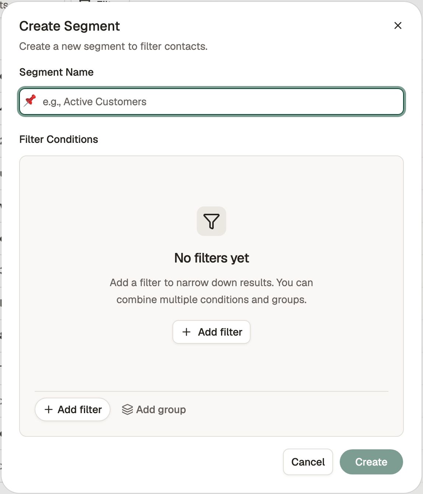

You have a saved group of contacts, such as *VIP customers* or *Ordered in the last 30 days*. A segment is a saved filter, so it always lists whoever matches it right now, and you can send it a WhatsApp campaign.

## Before you start

- To create and edit segments, you need the **Owner**, **Admin** or **Supervisor** role. Only **Owner** and **Admin** can delete them.
- The tags or [attributes](/contacts/attributes/) you want to filter by.

## Create a segment from the contact list

1. Open **Contacts** and select **All Contacts**.
2. Select **Filter** and add conditions, for example a tag, an attribute value or opt-in. Check that the list shows the contacts you expect.
3. Select **Save as segment**.
4. Enter a **Segment Name** and select **Save Segment**.

## Create a segment from scratch

1. In the **Contacts** sidebar, select **Create Segment**. You can also go to **Settings → Segments** and select **New segment**.

   

2. Enter a **Segment Name** and add the **Filter Conditions**.
3. Select **Create**.

Your segments are listed in the **Contacts** sidebar. Use a segment's **More** menu to **Edit** or **Delete** it.

## Check it works

Select the segment in the **Contacts** sidebar. Fufa lists the contacts that match its conditions right now.

## Common questions

### Does a segment update by itself?

Yes. A segment is a saved filter, not a fixed list. When a contact gains or loses a matching tag or attribute, they join or leave the segment automatically.

### How do I send a campaign to a segment?

In the campaign's **Audience** step, choose **Dynamic** and pick the segment under **Saved segment**. Only contacts who have opted in receive the campaign. See [Send a WhatsApp campaign](/campaigns/send-a-campaign/).

### Can I make segments of conversations too?

Yes. In the inbox, the same filters save as views. See [Views and assignment](/inbox/views-and-assignment/#save-your-own-view).

## Related

- [Send a WhatsApp campaign](/campaigns/send-a-campaign/)
- [Tag contacts and conversations](/contacts/tags/)
- [Subscribers](/contacts/subscribers/)
