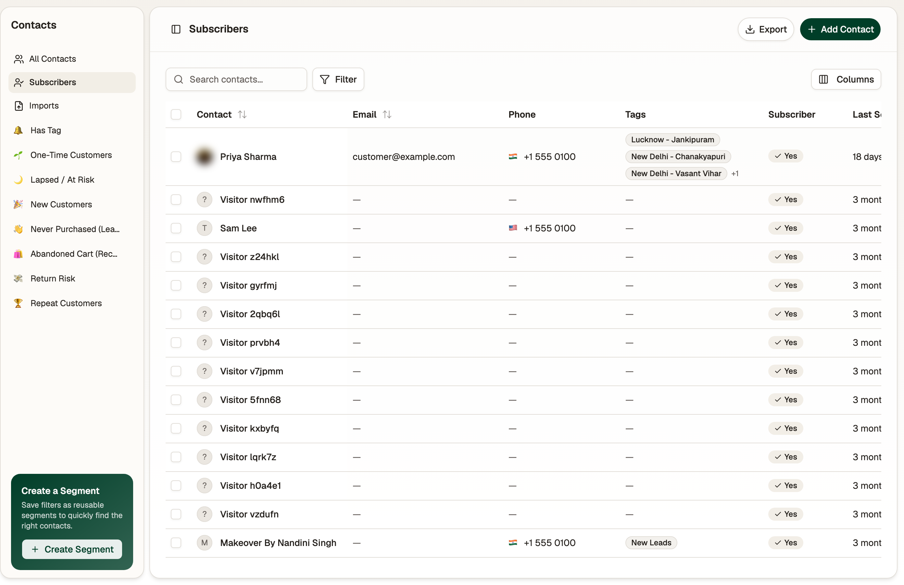

You know exactly who can receive your marketing messages. A subscriber is a contact who has opted in, and only subscribers receive [campaigns](/campaigns/send-a-campaign/).

## Before you start

- Every role can see subscribers and change a contact's opt-in.
- The customer's consent to receive marketing from you. WhatsApp requires it.

## See your subscribers

Open **Contacts** and select **Subscribers**. The list shows every contact who has opted in.

Contacts become subscribers when they sign up through an [opt-in popup](/campaigns/opt-in-popup/) on your website, or when you mark them yourself.

## Mark contacts as subscribers

1. In **All Contacts**, select the contacts who have agreed to receive marketing.
2. Choose **Mark as Subscriber**.

## Opt contacts out

1. Select the contacts, in **All Contacts** or **Subscribers**.
2. Choose **Opt Out**.

They stop receiving campaigns right away. You can still reply to them in the inbox.

## Check it works

Open **Subscribers**. The contacts you marked are listed, and the ones you opted out aren't.

## Common questions

### Who receives my campaigns?

Only contacts who have opted in. When you choose an audience, Fufa shows the **Total matching** contacts and how many of them are **Opted in**. Only the opted-in ones are sent the campaign.

### Are imported contacts subscribed?

No. Contacts you import, and customers who simply message you, aren't opted in. Mark them as subscribers only if they've agreed to receive marketing from you.

### Does opting someone out stop them from messaging me?

No. Opting out only stops campaigns. The contact can still write to you, and you can still reply in the inbox.

## Related

- [Collect opt-ins with a popup](/campaigns/opt-in-popup/)
- [Send a WhatsApp campaign](/campaigns/send-a-campaign/)
- [Manage contacts](/contacts/contacts/)
