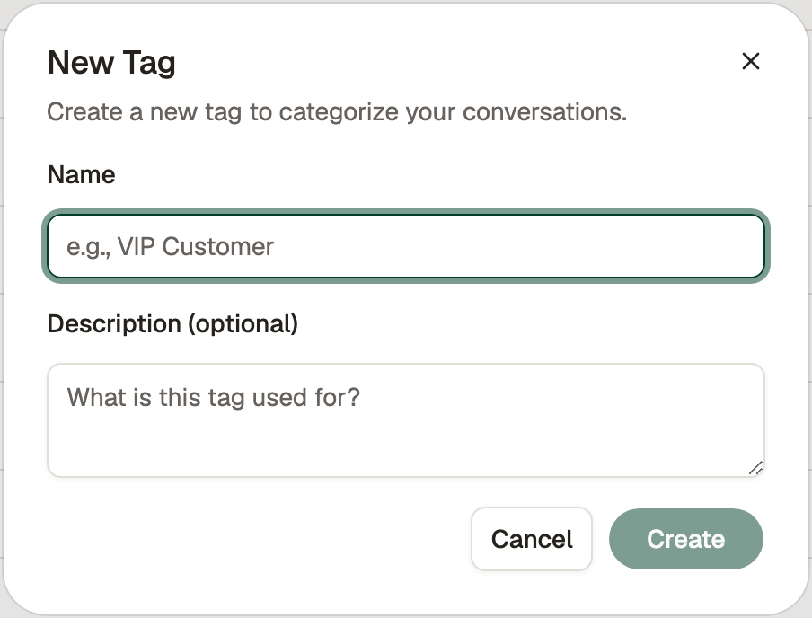

Your contacts and conversations carry labels you choose, such as *VIP*, *Wholesale* or *Refund requested*. You can filter by them in the inbox and in Contacts, and build segments from them.

## Before you start

- Every role can see tags and add them to contacts and conversations.
- To create tags, you need the **Owner**, **Admin**, **Supervisor** or **Agent** role. To rename or delete them, you need **Owner**, **Admin** or **Supervisor**.

## Create a tag

1. Go to **Settings → Tags**.
2. Select **New tag**.

   

3. Enter a **Name**, such as *VIP Customer*, and an optional description of what the tag is for.
4. Select **Create**. Fufa shows **Tag created successfully**.

## Tag a contact or a conversation

- **A contact**: open the contact in **Contacts** or from a conversation's contact panel, and select **Add contact tag**.
- **A conversation**: in the conversation header, select **Add conversation tag**.
- **Many conversations**: select them in the inbox list and choose **Add tag** in the bar that appears.
- **On import**: add tags to everyone in a CSV import. See [Manage contacts](/contacts/contacts/#import-contacts).

## Check it works

In **Contacts**, select **Filter** and filter by your tag. The contacts you tagged are listed.

## Common questions

### Are contact tags and conversation tags the same?

They come from the same list in **Settings → Tags**, but they're added separately. A tag on a conversation describes that conversation, and a tag on a contact describes the person across all their conversations.

### Can I target a campaign at a tag?

Yes. Build a [segment](/contacts/segments/) that filters contacts by the tag, then choose that segment as the campaign's audience.

### What happens to a tag's contacts when I delete it?

The tag is removed from every contact and conversation that had it. The contacts and conversations themselves aren't changed.

## Related

- [Group contacts into segments](/contacts/segments/)
- [Add contact attributes](/contacts/attributes/)
- [Views and assignment](/inbox/views-and-assignment/)
