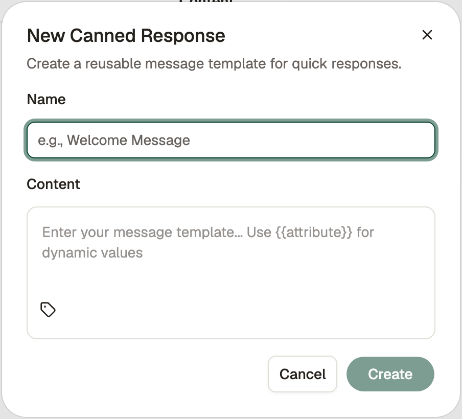

Your team answers common questions in a couple of keystrokes. A canned response is a saved reply that anyone on the team can insert into a conversation and edit before sending.

## Before you start

- To create and edit canned responses, you need the **Owner**, **Admin** or **Supervisor** role. Only **Owner** and **Admin** can delete them.
- Every role can insert canned responses in the inbox.

## Create a canned response

1. Go to **Settings → Templates → Canned Responses**.
2. Select **New response**.

   

3. Give it a **Name** your team will recognise, such as *Shipping times*.
4. Write the **Content**. To add the customer's details, put an attribute in double braces, for example `Hi {{firstName}}`. You can use `name`, `firstName`, `lastName`, `phone`, `email` and the key of any [contact attribute](/contacts/attributes/).
5. Select **Create**.

To change one, select **Edit** on its row. Your changes apply the next time someone inserts it.

## Use it in a conversation

1. In the composer, type `/`.
2. Keep typing the name to narrow the list. Canned responses are listed under **Canned Responses**, next to **WhatsApp Templates**.
3. Select one. Its text is inserted, with the contact's details filled in.
4. Edit it if you need to, then send.

## Check it works

Open any conversation, type `/` in the composer and search for the name you saved. The response appears in the list.

## Common questions

### Can I use canned responses on every channel?

Yes. They're inserted as normal text, so they work on WhatsApp, live chat, Instagram, email and Telegram. On WhatsApp, a free-form reply can only be sent within 24 hours of the customer's last message.

### What's the difference between a canned response and a WhatsApp template?

A canned response is your own saved text, used inside an open conversation. A WhatsApp template is approved by Meta and is the only way to message a customer on WhatsApp outside the 24-hour window. See [Create a WhatsApp template](/campaigns/whatsapp-templates/).

### Can the AI agent use my canned responses?

No. Canned responses are for your team. To teach the AI agent an exact answer, add a Q&A to the agent's **Data Sources**. See [Create an agent](/agents/create-an-agent/).

## Related

- [Reply from the inbox](/inbox/reply/)
- [Create a WhatsApp template](/campaigns/whatsapp-templates/)
- [Contact attributes](/contacts/attributes/)
