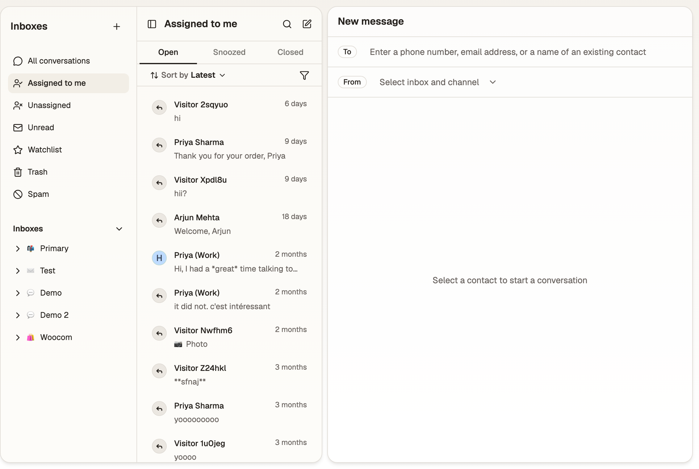

You send the first message to a customer, instead of waiting for them to write. The conversation opens in your inbox, and their replies land in the same thread.

## Before you start

- At least one connected channel, such as [WhatsApp](/channels/whatsapp/) or [email](/channels/email/).
- Access to the inbox you'll send from.
- On WhatsApp, an approved message template. WhatsApp only allows a business to start a conversation with a template.

## Write the message

1. Open **Inbox** and select the new message button, the pencil icon at the top of the conversation list. Fufa opens **New message**.

   

2. Next to **To**, search for the contact by name, phone number or email address. If they aren't in Fufa yet, type their phone number or email and select **Create contact**.
3. Select **Select inbox and channel** and choose where to send from, for example your WhatsApp number or your support email address.
4. Write your message, or type `/` to insert a canned response or a template. On WhatsApp, choose an approved template.
5. Send it. Fufa shows **Message sent** and opens the conversation.

If you already have a conversation with that contact on that channel, Fufa shows **Existing conversation**. Select it to continue there instead.

## Check it works

The conversation appears in your inbox with your message in it. When the customer replies, their message arrives in the same conversation.

## Common questions

### Why can't I type a free-form WhatsApp message to a new customer?

WhatsApp only lets a business start a conversation with an approved template. Choose a template in the composer. Once the customer replies, you can write freely for 24 hours. Templates are managed in **Settings → Templates → WhatsApp Templates**.

### Why does it say No channels available?

None of your inboxes has a connected channel you can send from, or you don't have access to the inbox that does. Connect a channel in **Settings → Inboxes**, or ask an **Owner** or **Admin** to give you access to the inbox.

### Can I message many customers at once?

Not from here. To message a list or segment of customers, [send a campaign](/campaigns/send-a-campaign/).

## Related

- [Reply from the inbox](/inbox/reply/)
- [Create a WhatsApp template](/campaigns/whatsapp-templates/)
- [Send a WhatsApp campaign](/campaigns/send-a-campaign/)
