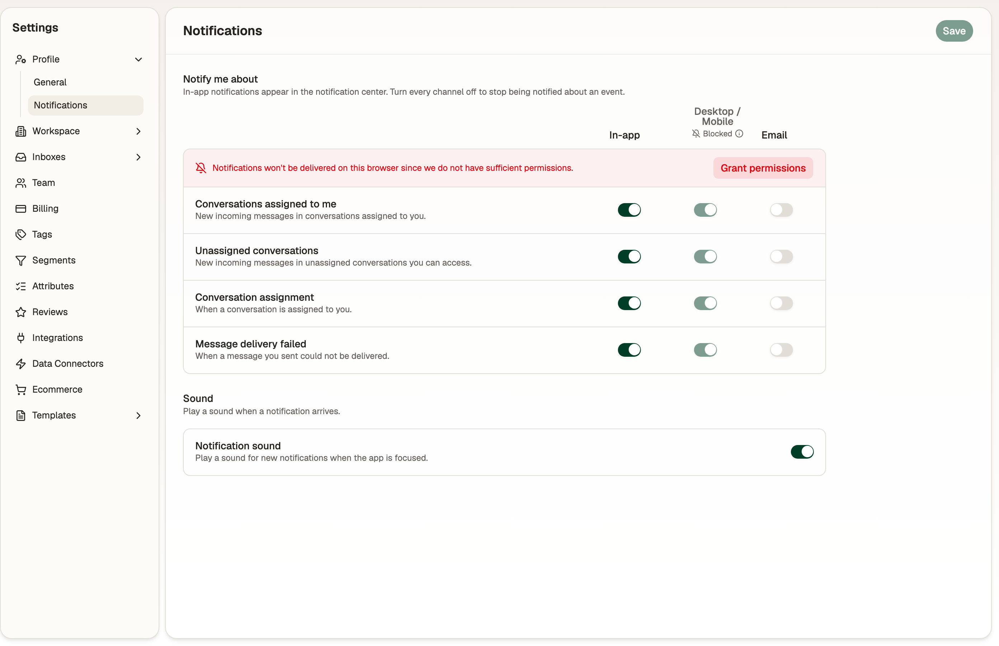

Fufa tells you when a customer writes to you, when a conversation is assigned to you, and when a message you sent fails. You choose where each alert reaches you: in Fufa, as a notification on your computer or phone, or by email.

## Before you start

- Any role can set up notifications. Each person chooses their own.
- On iPhone or iPad, [install Fufa on your home screen](/start/install-on-your-phone/) first. Phone notifications on iPhone need iOS 16.4 or later.

## Choose what notifies you

1. Go to **Settings → Profile → Notifications**. On a computer, you can also open your profile menu at the bottom of the sidebar and select **Notifications**.
2. Under **Notify me about**, each event has three switches: **In-app**, **Desktop / Mobile** and **Email**. On a phone, the switches are labelled **In-app**, **Desktop** and **Email** under each event.

   

   | Event | When it notifies you |
   | --- | --- |
   | **Conversations assigned to me** | New incoming messages in conversations assigned to you. |
   | **Unassigned conversations** | New incoming messages in unassigned conversations you can access. |
   | **Conversation assignment** | When a conversation is assigned to you. |
   | **Message delivery failed** | When a message you sent could not be delivered. |

3. Turn each switch on or off. Turn all three off to stop being notified about an event.
4. Select **Save**. Fufa shows **Notifications settings updated**.

**In-app** and **Desktop / Mobile** start on for every event. **Email** starts off.

## Allow notifications on this device

Notifications on your computer or phone need your browser's permission, once on each device.

1. On the device you want alerts on, open **Settings → Profile → Notifications**.
2. If you see *Notifications won't be delivered on this browser since we do not have sufficient permissions.*, select **Grant permissions**. Otherwise, turn on a **Desktop / Mobile** switch, labelled **Desktop** on a phone.
3. When your browser asks, choose **Allow**. Fufa shows **Desktop notifications enabled**.
4. Select **Save**.

Repeat this on each computer and phone you use. On iPhone, do it inside Fufa opened from the home screen icon, not in Safari.

### If notifications are blocked

If you chose **Block** earlier, your browser won't ask again. On a computer, the **Desktop / Mobile** column shows **Blocked**. On a phone, the **Desktop** switches are greyed out. Allow Fufa yourself:

- **Chrome or Edge on a computer**: select the icon at the left of the address bar, then set **Notifications** to **Allow**.
- **Android**: open Chrome's **⋮** menu → **Settings** → **Site settings** → **Notifications**, and allow apps.fufa.ai. If you installed Fufa, you can also allow it in your phone's **Settings → Apps → Fufa AI → Notifications**.
- **iPhone or iPad**: open your phone's **Settings → Notifications → Fufa AI** and turn on **Allow Notifications**.

Then return to **Settings → Profile → Notifications** in Fufa and turn the switches on again.

## Sound

Under **Sound**, **Notification sound** plays a short sound when a notification arrives while Fufa is open. Turn it off and select **Save** to keep Fufa silent.

## See your notifications in Fufa

Select **Notifications** in the sidebar to open the notification center. A badge shows how many are unread. Switch between **Unread** and **All**, select a notification to open its conversation, or select **Mark all read**. On a phone, it's under **More → Notifications**.

## Check it works

Ask a teammate to assign you a conversation, or send a message to one of your channels from another phone. A notification titled **Conversation assigned to you** or **New message** appears on your device within a few seconds.

## Common questions

### Why am I not getting notifications on my iPhone?

On iPhone and iPad, notifications only work when Fufa is installed on your home screen, on iOS 16.4 or later. Install it from Safari with **⋯ → Share → Add to Home Screen** and open Fufa from the new icon. Then go to **Settings → Profile → Notifications**, select **Grant permissions** or turn on a **Desktop** switch, and choose **Allow**.

### Why don't I get notified about every new message?

Fufa notifies you about new messages in conversations assigned to you, and in unassigned conversations if your role can see all conversations in that inbox. If an AI agent is handling a conversation, nobody is notified, because the agent is replying. You're notified again once the conversation is handed to your team.

### When do email notifications arrive?

Emails about new messages are sent only while your status is **Offline**, and only for messages that are still unread. Fufa waits about five minutes so several messages arrive in one email, and never holds an email for more than 30 minutes. Emails about assignments and failed messages are sent right away.

### Do notifications work when Fufa is closed?

Yes. Once you've allowed notifications on a device, they arrive even when Fufa isn't open. The notification sound plays only while Fufa is open.

### I use Fufa on two devices. Do I set this up twice?

Your choices of which events notify you are saved to your account and apply everywhere. Browser permission is per device, so allow notifications once on each computer and phone.

## Related

- [Install Fufa on your phone](/start/install-on-your-phone/)
- [Views and assignment](/inbox/views-and-assignment/)
- [Reply from the inbox](/inbox/reply/)
