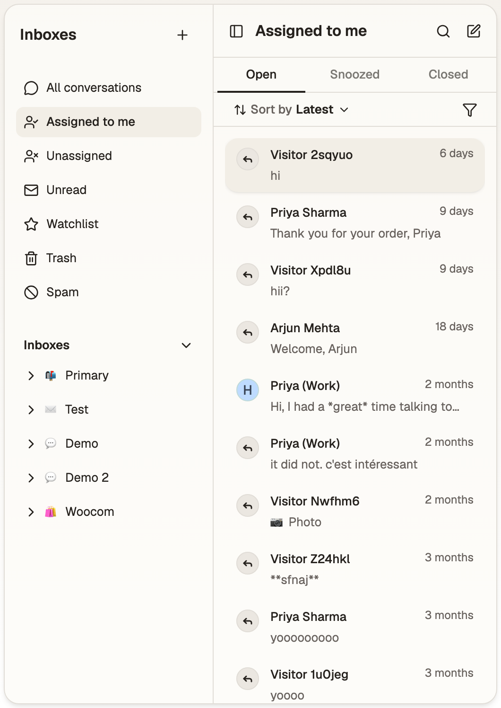

You see the conversations that need you, and every conversation has a clear owner: a teammate, the AI agent, or nobody yet. Your own saved views sit in the inbox next to the built-in ones.

## Before you start

- Access to at least one inbox. Your role and inboxes are set in [Invite your team](/workspace/team/).
- The **Owner**, **Admin** and **Supervisor** roles see every conversation. The **Agent** role sees only the conversations assigned to them, so for them every view is filtered to their own conversations, and **All conversations** isn't shown.

## Use the built-in views

Open **Inbox**. Each inbox in the left panel opens to these views:

| View | What it shows |
| --- | --- |
| **All conversations** | Every conversation in the inbox. |
| **Assigned to me** | Conversations assigned to you. |
| **Unassigned** | Conversations no teammate owns yet. |
| **Unread** | Conversations with messages nobody has read. |
| **Watchlist** | Conversations you've highlighted to keep an eye on. |
| **Trash** | Conversations moved to trash. |
| **Spam** | Conversations reported as spam. |

Above the list, switch between **Open**, **Snoozed** and **Closed**, and choose **Sort by** **Latest**, **Oldest** or **Priority**.

To add a conversation to **Watchlist**, open it and choose **Highlight** from the conversation menu. Choose **Unhighlight** to remove it.

## Save your own view

1. In the conversation list, select **Filter**.
2. Add conditions, for example a tag, a channel or an assignee. With more than one group of conditions, choose whether to **Match** **all** or **any** of them.
3. Select **Save as segment**.
4. Enter a **View Name** and select **Save View**.

Your view appears under **Views** in the left panel. Use its **More** menu to **Edit** or **Delete** it.

## Assign a conversation

1. Open the conversation. The assignment button in the header shows its owner: **Assign** when nobody owns it, **AI** when an AI agent is replying, or **Assigned** with the teammate's avatar.
2. Select it and choose a teammate. Type to search.

Once a teammate is assigned, the AI agent stops replying to that conversation. The teammate is notified if they've [turned on notifications](/inbox/notifications/).

To assign many conversations at once, select them in the list and choose **Assign** in the bar that appears.

## Hand a conversation back to the AI agent

1. Select the assignment button in the conversation header.
2. Under **Let the AI bot handle it**, select **Hand back**. This option appears when a teammate is assigned.

The AI agent replies to the customer automatically again. For many conversations, select them in the list, choose **Assign**, then **Hand all back**.

## Check it works

Assign a conversation to yourself. It appears in **Assigned to me**, and the header shows **Assigned** with your avatar.

## Common questions

### What's the difference between Unassigned and AI?

**Unassigned** means no teammate owns the conversation. If an AI agent is live on that channel, the agent replies and the header shows **AI**. If no agent is live, the conversation waits for someone on your team to pick it up.

### Why can't I see All conversations?

**All conversations** is shown only to the **Owner**, **Admin** and **Supervisor** roles. The **Agent** role sees only the conversations assigned to them, in **Assigned to me** and the other views. Ask an **Owner** or **Admin** to assign you conversations, or to change your role in **Settings → Team**.

### Does assigning a conversation stop the AI agent?

Yes. While a teammate is assigned, the AI agent doesn't reply to that conversation. To let it reply again, open the assignment button and select **Hand back** under **Let the AI bot handle it**.

### Can I share a saved view with my team?

Saved views are stored in the workspace, so everyone with access to the inbox sees them under **Views**.

## Related

- [Reply from the inbox](/inbox/reply/)
- [Turn on notifications](/inbox/notifications/)
- [Start a new conversation](/inbox/new-message/)
