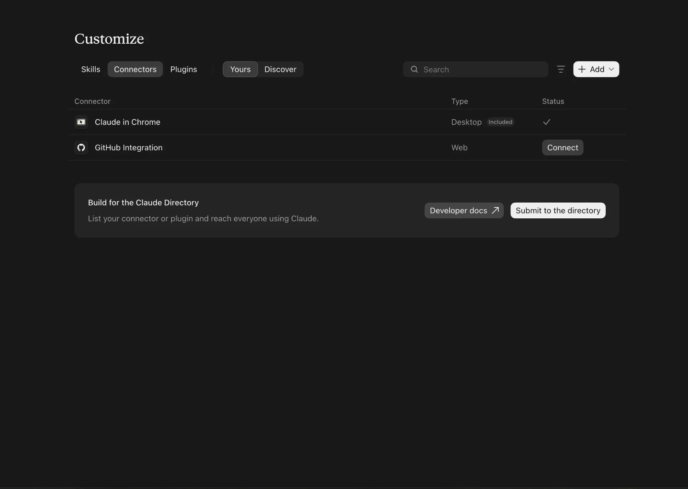
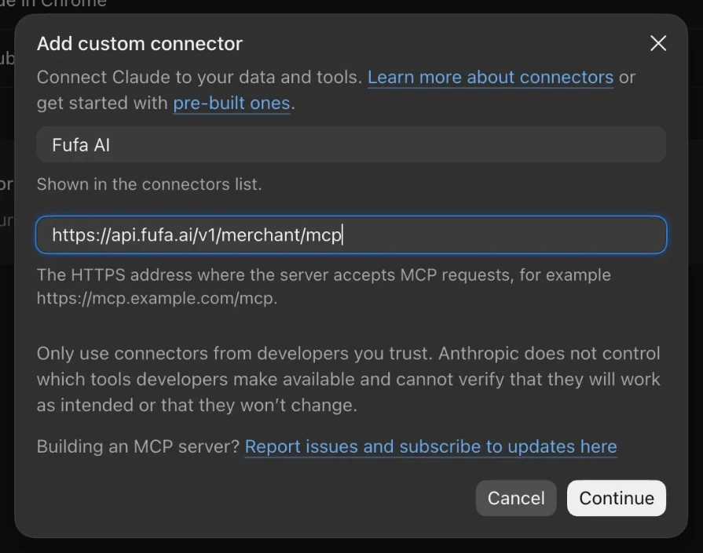
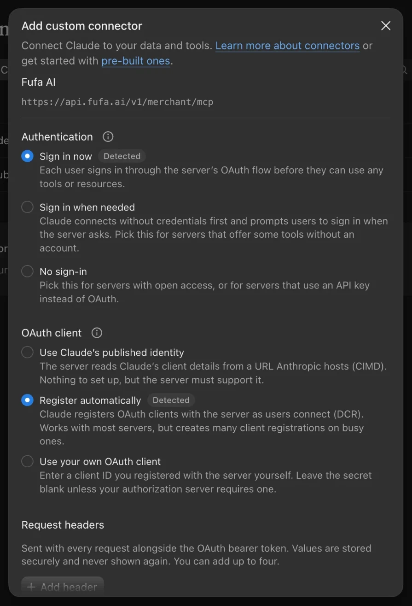
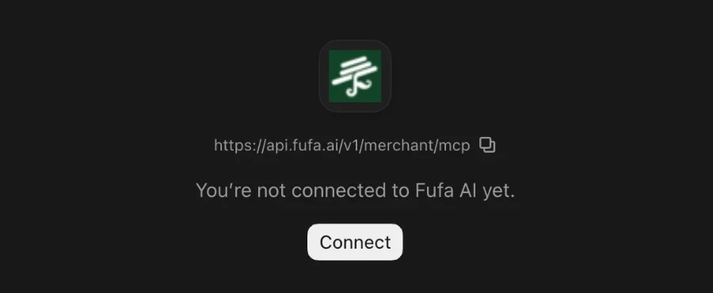
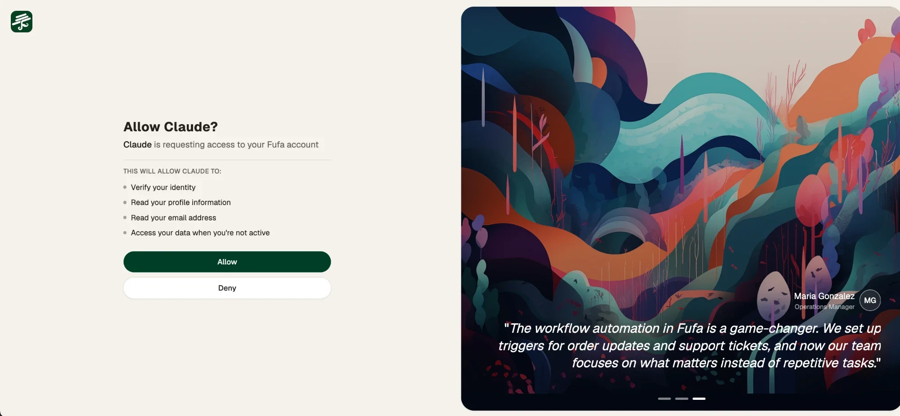
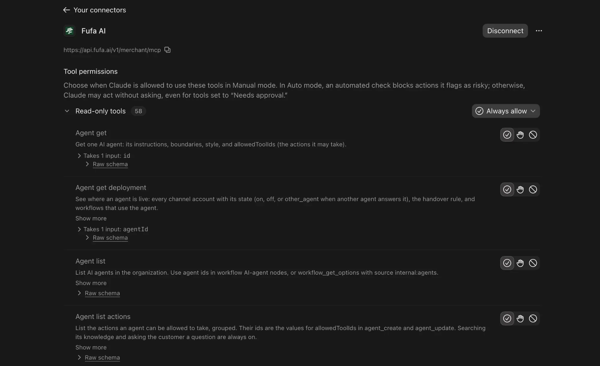
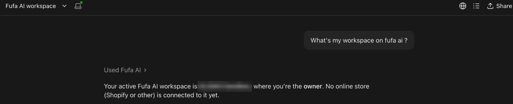

Claude is connected to your Fufa workspace through the Fufa MCP server. You can ask Claude about your AI agents, conversations, campaigns, contacts and orders in plain language, and let it act on them, without opening Fufa.

The steps work the same on claude.ai and in the Claude desktop app. Setup takes about three minutes.

## Before you start

- A Fufa account you can sign in to. Claude can do only what your role in the workspace allows.
- A Claude account on claude.ai or the Claude desktop app.
- The Fufa MCP server URL: `https://api.fufa.ai/v1/merchant/mcp`

## Add Fufa as a connector

1. In Claude, open **Customize** and pick the **Connectors** tab. Click **+ Add** in the top right and choose to add a custom connector.

   

2. Name the connector **Fufa AI**, or anything you'll recognise. Paste `https://api.fufa.ai/v1/merchant/mcp` as the URL and click **Continue**.

   

3. Claude detects the sign-in settings: **Authentication** set to **Sign in now** and **OAuth client** set to **Register automatically**, both marked **Detected**. Leave them as they are, add no request headers, and finish adding the connector.

   

4. The connector appears in your list, not yet signed in. Open it and click **Connect**.

   

5. A Fufa sign-in window opens. Sign in if you need to, review what Claude asks for, and click **Allow**.

   

## Choose which tools Claude can use

Back in Claude, the connector page lists every Fufa tool, grouped by what it does. [What you can do with Fufa MCP](/mcp/tools/) explains each one. Read-only tools only look things up, such as listing agents, reading conversations or pulling reports.

1. For each tool or group, pick **Always allow**, **Needs approval** or **Blocked**.
2. Set read-only tools to **Always allow**. They can't change anything in your workspace.
3. Set tools that change things, such as sending campaigns, replying to customers or editing agents and workflows, to **Needs approval**, so Claude asks before each action.

:::caution
In Claude's Auto mode, Claude may run a tool without asking, even one set to **Needs approval**. Set a tool to **Blocked** if Claude should never run it.
:::

## Check it works

Open a new chat and ask something only your Fufa account knows, such as "What's my workspace on Fufa AI?" Claude shows **Used Fufa AI** above its answer and replies with your active workspace, your role in it, and whether a store is connected.

If you belong to more than one workspace, ask Claude to list them and switch to the one you want first. Some prompts to try next, and more in [Things to ask Fufa MCP](/mcp/examples/):

- "List my AI agents and tell me which channels each one is live on."
- "Summarise today's open WhatsApp conversations that haven't been answered."
- "How did last week's campaign perform? Show sends, reads and replies."
- "Which WhatsApp templates are still waiting for approval?"

## Common questions

### Is connecting Fufa to Claude safe?

Yes. Each person signs in with their own Fufa account, and every tool call is checked against that account's role in the workspace, so Claude can only reach what you can. You choose which tools Claude may run, and you can disconnect at any time.

### Why does the Fufa connector stay "not connected"?

The Fufa sign-in didn't finish. Click **Connect** again and complete the sign-in in the same browser, and allow pop-ups if your browser blocked the sign-in window.

### Why can't Claude find my orders or products?

Claude is probably using a workspace with no store connected. Ask Claude which workspace is active and switch if needed. A workspace without a store answers workspace questions but has no orders or products to return.

### Why doesn't Claude use Fufa when I ask a question?

The connector may be off for that chat. Turn on the Fufa AI connector for the chat, and mention Fufa in your question so Claude knows which tool to use.

### How do I disconnect Fufa from Claude?

Open the connector in Claude under **Customize → Connectors** and click **Disconnect**.

### Can I use the Fufa MCP server from Claude Code or my own code?

Yes, with an MCP API key. You can't create keys in Fufa yet, so email team@fufa.ai from your registered email address and ask for an MCP API key. See [Use Fufa MCP from other clients](/mcp/other-clients/). The chat setup on this page needs no key.

## Related

- [What you can do with Fufa MCP](/mcp/tools/)
- [Things to ask Fufa MCP](/mcp/examples/)
- [Use Fufa MCP from other clients](/mcp/other-clients/)
- [Invite your team](/workspace/team/)
