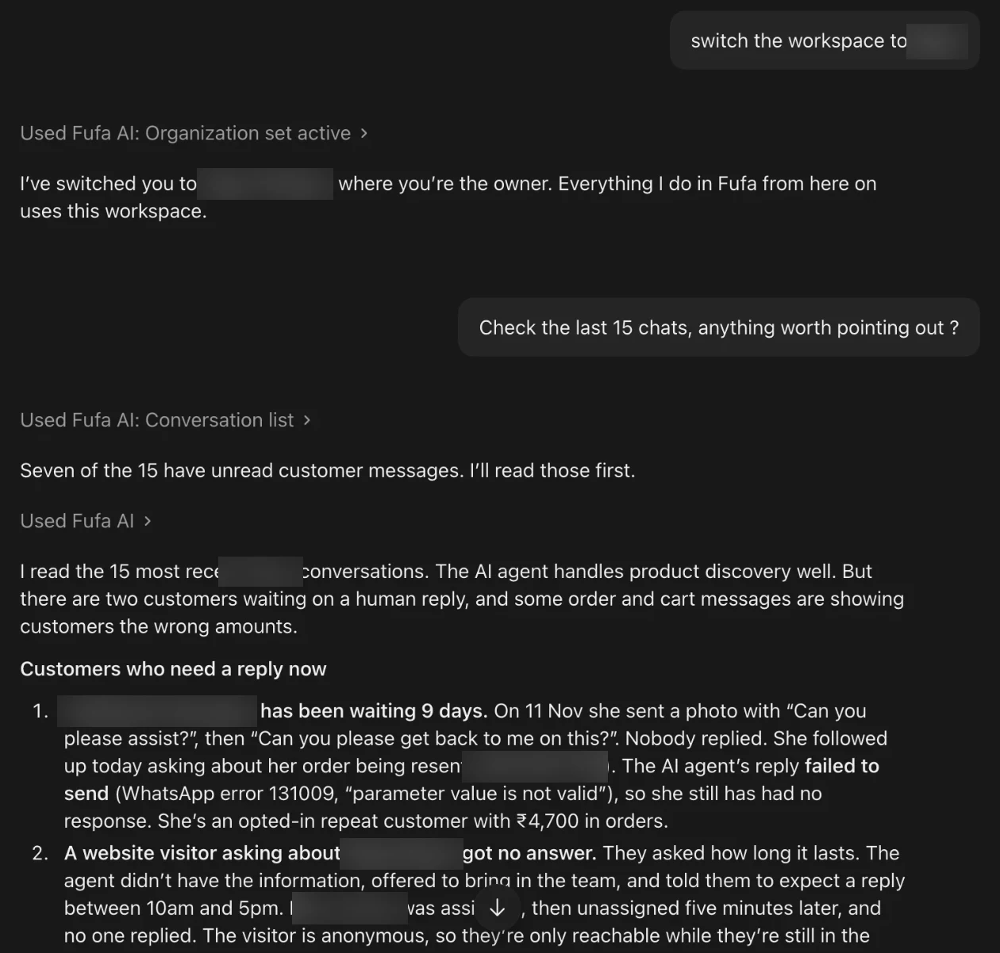

These prompts show what an AI client connected to Fufa can do in one conversation. Copy one, change the details to fit your store, and the client picks the tools it needs.

Each example names the tools the client usually calls, so you know what to allow. Prompts that message customers or go live stop and ask you before that step.

## Before you start

- A client connected to Fufa: [Connect Fufa to Claude](/mcp/claude-connector/) or [Use Fufa MCP from other clients](/mcp/other-clients/).
- The right workspace active. Start with "Which Fufa workspace am I in?" if you belong to more than one.

## Look things up

Quick questions that only read your workspace:

- "Check the last 15 chats. Anything worth pointing out?"
- "Which of my AI agents are live, and on which channels?"
- "Show me unassigned WhatsApp conversations from today and summarise what each customer wants."
- "Find every conversation where a customer mentioned a refund this week."
- "How many abandoned carts did we have in the last 7 days, and what were the top products in them?"
- "Which WhatsApp templates were rejected, and why?"
- "Which pre-built automations are off, and what does each one still need?"

Asked to check recent chats, Claude reads the conversations and their messages, then points out customers still waiting on a reply and messages that failed to send:

## Build an agent from your website

> Create a support agent for my store from www.example.com. Crawl the site, add our returns policy below as knowledge, then test it with three questions a customer might ask about shipping and returns. Don't turn it on yet.

The client creates the agent with `agent_create_from_description`, teaches it with `knowledge_crawl_website` and `knowledge_add_text`, waits until `knowledge_list_sources` shows the sources are ready, and tries it with `agent_test`. When you're happy, ask it to turn the agent on for a channel. It uses `agent_set_channel` and asks you first.

## Run a WhatsApp campaign

> Draft a WhatsApp campaign for my "Lapsed buyers" segment using our "winback_offer" template. Tell me how many people it will reach and how many are opted in, then send a test to my own number.

The client finds the segment with `segment_list` (or builds one with `contact_filter_metadata` and `segment_create` if you describe the audience instead), checks its size with `campaign_estimate_recipients`, and sets up the draft with `campaign_create_draft` and `campaign_update`. The test with `campaign_send_test` asks you first. Nothing goes out to customers until you ask it to send and approve `campaign_send`.

## Write a WhatsApp template

> Write a WhatsApp utility template that tells customers their order has shipped, with their first name and a tracking link. Show it to me before submitting.

The client drafts it with `whatsapp_template_create_draft` and `whatsapp_template_update`, shows you the text, and submits it with `whatsapp_template_submit` once you approve. Ask "Is my shipping template approved yet?" later to check with `whatsapp_template_get`.

## Clear the inbox

> Go through open conversations older than two days. Close the ones where the customer said thanks or the issue is solved, add a note saying why, and assign the rest to the team round robin.

The client reads conversations with `conversation_list` and `conversation_list_messages`, then uses `conversation_add_note`, `conversation_close` and `conversation_assign`. None of these message the customer. If you also ask it to reply, each `conversation_reply` asks you first.

## Get a weekly report

> Give me last week's numbers by channel: conversations, how many the AI resolved, and orders. Compare with the week before.

The client finds the metrics with `report_catalog` and runs `report_query` with up to five numbers per channel and a comparison with the previous period. It repeats any notes the report returns, such as a number that isn't available yet.

## Follow up on a campaign

> Last Friday's campaign: who didn't read it? Create a follow-up draft just for them with the same template.

The client checks results with `campaign_get_analytics`, then creates the follow-up with `campaign_retarget` aimed at unread recipients. It stays a draft until you ask to send it.

## Set up a workflow

> Build a workflow that runs when a customer messages us on WhatsApp: if they're in my "VIP customers" segment, tag the conversation "vip" and assign it to Priya. Check it for errors, but don't publish it.

The client reads the available steps with `workflow_get_manifest` and `workflow_get_options`, saves the draft with `workflow_create` and `workflow_save_draft`, and checks it with `workflow_validate`. Publishing with `workflow_publish` asks you first.

## Common questions

### Why did the client ask me before running a step?

The step messages customers, goes live or can't be undone, so the tool tells the client to confirm with you first. Check the details it shows and approve, or say no and change the request.

### Can I run these prompts on a schedule?

Fufa MCP answers when a client calls it, and doesn't run on its own. To run something on a schedule, use your client's scheduling feature if it has one, or set it up as a Fufa workflow or automation.

### Why did the client say a number isn't available?

Some report metrics aren't ready for every workspace yet. The client reads this from `report_catalog` and tells you why, so ask for a related number instead.

## Related

- [What you can do with Fufa MCP](/mcp/tools/)
- [Connect Fufa to Claude](/mcp/claude-connector/)
- [Use Fufa MCP from other clients](/mcp/other-clients/)
