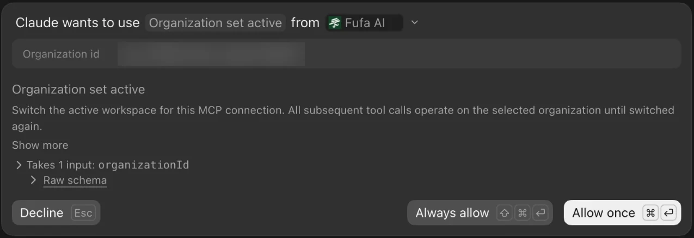

The Fufa MCP server lets an AI client such as Claude work in your Fufa workspace for you. It can read and change your agents, conversations, contacts, campaigns, WhatsApp templates, workflows and reports. This page lists every tool it offers, in one line each, so you know what to ask for.

You don't call tools by name. Ask in plain words, such as "Pause last week's campaign", and the client picks the tools it needs.

## Before you start

- Connect a client first: [Connect Fufa to Claude](/mcp/claude-connector/) or [Use Fufa MCP from other clients](/mcp/other-clients/).
- The client can do only what your role in the workspace allows. A tool your role can't use returns an error instead of running.

## How to read the tables

Each tool is marked with what it does to your workspace:

- **Reads only**: looks things up. Nothing in your workspace changes.
- **Makes changes**: creates or edits something, such as a draft, a tag or a note. Nothing reaches a customer.
- **Asks first**: messages real customers, goes live, or can't be undone. The tool tells the AI client to confirm with you before it runs.

When a tool needs your approval, the client shows you the tool and the values it will send before anything runs. In Claude it looks like this:

:::caution
Tools that message customers, such as sending a campaign or replying in a conversation, send real messages and are charged like messages sent from Fufa. Set them to need your approval in your client.
:::

## Workspace

| Tool | What it does | Effect |
| --- | --- | --- |
| `organization_list` | Lists the workspaces you belong to and shows which one is active. | Reads only |
| `organization_set_active` | Switches the workspace every later tool works in. | Makes changes |

## AI agents

| Tool | What it does | Effect |
| --- | --- | --- |
| `agent_list` | Lists the AI agents in the workspace. | Reads only |
| `agent_get` | Shows one agent's instructions, boundaries, style and allowed actions. | Reads only |
| `agent_get_deployment` | Shows which channels an agent is live on, its handover rule and the workflows that use it. | Reads only |
| `agent_list_actions` | Lists the actions an agent can be allowed to take. | Reads only |
| `agent_create` | Creates an agent from instructions you write. | Makes changes |
| `agent_create_from_description` | Creates an agent from a one or two sentence description and writes its instructions for you. | Makes changes |
| `agent_update` | Changes an agent's name, instructions, boundaries, style or allowed actions. | Makes changes |
| `agent_test` | Sends an agent one test message and returns its reply. No customer is messaged, but connectors the agent uses are called for real. | Makes changes |
| `agent_set_handover` | Sets what happens when an agent can't help: hand over to the team or close the conversation. | Makes changes |
| `agent_set_channel` | Turns an agent on or off for one channel, where it starts or stops replying to real customers. | Asks first |
| `agent_delete` | Deletes an agent. It stops replying on every channel. | Asks first |

## Agent knowledge

| Tool | What it does | Effect |
| --- | --- | --- |
| `knowledge_list_sources` | Lists an agent's knowledge sources and whether each is ready. | Reads only |
| `knowledge_list_documents` | Lists the pages inside one knowledge source, such as a crawled website. | Reads only |
| `knowledge_add_text` | Teaches an agent from text you give it, such as a policy or product notes. | Makes changes |
| `knowledge_add_qa` | Teaches an agent one question and the exact answer to give. | Makes changes |
| `knowledge_add_url` | Teaches an agent from one public web page. | Makes changes |
| `knowledge_crawl_website` | Teaches an agent from a whole website, following links up to a page limit. | Makes changes |
| `knowledge_delete_source` | Removes a knowledge source and everything the agent learned from it. | Asks first |

## Conversations

| Tool | What it does | Effect |
| --- | --- | --- |
| `inbox_list` | Lists the inboxes in the workspace. | Reads only |
| `conversation_list` | Lists conversations you can see, filtered by inbox, contact, channel, segment or search. | Reads only |
| `conversation_get` | Shows one conversation's contact, channel, status, priority, assignee and tags. | Reads only |
| `conversation_list_messages` | Reads the messages in a conversation, including internal notes. | Reads only |
| `conversation_search_messages` | Searches message text across all conversations. | Reads only |
| `conversation_get_summary` | Shows a conversation's saved summary, when it has one. | Reads only |
| `conversation_filter_metadata` | Lists the fields and operators you can filter conversations by. | Reads only |
| `conversation_add_note` | Adds an internal note only your team sees. | Makes changes |
| `conversation_assign` | Assigns a conversation to a teammate, or lets the inbox pick by round robin. | Makes changes |
| `conversation_unassign` | Removes the assignee from a conversation. | Makes changes |
| `conversation_add_tag` | Adds a tag to a conversation. | Makes changes |
| `conversation_remove_tag` | Removes a tag from a conversation. | Makes changes |
| `conversation_set_priority` | Sets a conversation's priority to low, normal, high or urgent. | Makes changes |
| `conversation_snooze` | Snoozes a conversation until a time you choose. | Makes changes |
| `conversation_close` | Closes a conversation as resolved. | Makes changes |
| `conversation_reopen` | Reopens a closed conversation. | Makes changes |
| `conversation_reply` | Sends a text reply to the customer on the conversation's channel. It can't be unsent. | Asks first |

## Contacts

| Tool | What it does | Effect |
| --- | --- | --- |
| `contact_list` | Lists contacts, with filters, search and pages. | Reads only |
| `contact_getById` | Shows one contact with all their fields, tags and attributes. | Reads only |
| `contact_count` | Counts the contacts that match a filter, segment or search. | Reads only |
| `contact_get_tags` | Lists the tags on a contact. | Reads only |
| `contact_filter_metadata` | Lists the fields and operators you can filter contacts by. | Reads only |
| `contact_create` | Adds a contact with an email or phone number. | Makes changes |
| `contact_update` | Changes a contact's details and custom fields. | Makes changes |
| `contact_add_tag` | Adds a tag to a contact. | Makes changes |
| `contact_remove_tag` | Removes a tag from a contact. | Makes changes |
| `contact_set_opt_in` | Records whether contacts agreed to receive marketing messages. | Asks first |
| `contact_delete` | Deletes a contact. | Asks first |

## Tags, attributes and segments

| Tool | What it does | Effect |
| --- | --- | --- |
| `tag_list` | Lists the workspace's tags. | Reads only |
| `tag_create` | Creates a tag with a name and color. | Makes changes |
| `attribute_list` | Lists the custom contact fields. | Reads only |
| `attribute_create` | Creates a custom contact field, such as a text, number, date or choice field. | Makes changes |
| `segment_list` | Lists audience segments. | Reads only |
| `segment_get` | Shows one segment and its filters. | Reads only |
| `segment_create` | Creates an audience segment from filters. | Makes changes |
| `segment_update` | Changes a segment's name, icon or filters. | Makes changes |

## Campaigns

| Tool | What it does | Effect |
| --- | --- | --- |
| `campaign_list` | Lists campaigns with their status and audience size. | Reads only |
| `campaign_get` | Shows one campaign's channel, segment, template, schedule and status. | Reads only |
| `campaign_estimate_recipients` | Estimates how many contacts a segment would reach, and how many are opted in and reachable. | Reads only |
| `campaign_list_draft_recipients` | Lists the contacts on a draft campaign's recipient list. | Reads only |
| `campaign_get_stats` | Shows how many messages were sent, delivered, read and clicked. | Reads only |
| `campaign_get_analytics` | Shows a campaign's full results, including revenue from orders it brought in. | Reads only |
| `campaign_list_broadcasts` | Lists each recipient with the delivery status of their message. | Reads only |
| `campaign_get_broadcast_count` | Counts recipients, optionally only those with one status such as read or undelivered. | Reads only |
| `campaign_create_draft` | Starts a new campaign as an empty draft. | Makes changes |
| `campaign_update` | Sets a draft's name, channel, template, audience and schedule. | Makes changes |
| `campaign_add_recipients` | Adds contacts to a draft's recipient list. | Makes changes |
| `campaign_remove_recipients` | Removes contacts from a draft's recipient list. | Makes changes |
| `campaign_replace_recipients` | Sets a draft's recipient list to exactly the contacts you choose. | Makes changes |
| `campaign_clear_recipients` | Removes every recipient from a draft. | Makes changes |
| `campaign_duplicate` | Copies a campaign into a new draft. | Makes changes |
| `campaign_retarget` | Creates a follow-up draft aimed at some of a finished campaign's recipients, such as those who didn't read it. | Makes changes |
| `campaign_pause` | Pauses a running campaign. | Makes changes |
| `campaign_send_test` | Sends the campaign's message to one contact as a test. The message is real and charged. | Asks first |
| `campaign_send` | Sends a campaign to its whole audience, now or at its scheduled time. | Asks first |
| `campaign_resume` | Resumes a paused campaign and sends the remaining messages. | Asks first |
| `campaign_cancel` | Cancels a scheduled campaign before it starts sending. | Asks first |
| `campaign_delete` | Deletes a campaign and its results. | Asks first |

## WhatsApp templates

| Tool | What it does | Effect |
| --- | --- | --- |
| `whatsapp_template_list` | Lists the WhatsApp templates for a business account. | Reads only |
| `whatsapp_template_get` | Shows one template's text, buttons, placeholders, status and rejection reason. | Reads only |
| `whatsapp_template_create_draft` | Starts a new template as an empty draft. | Makes changes |
| `whatsapp_template_update` | Writes or changes a draft template. | Makes changes |
| `whatsapp_template_duplicate` | Copies a template into a new draft, the way to change one already submitted. | Makes changes |
| `whatsapp_template_archive` | Hides an approved template from pickers. It stays approved. | Makes changes |
| `whatsapp_template_unarchive` | Brings an archived template back. | Makes changes |
| `whatsapp_template_submit` | Sends a draft to WhatsApp for approval. It can no longer be edited after. | Asks first |
| `whatsapp_template_delete` | Deletes a template in Fufa and on WhatsApp. | Asks first |

## Channels

| Tool | What it does | Effect |
| --- | --- | --- |
| `channel_account_list` | Lists your connected accounts for one channel, such as WhatsApp, Instagram or website chat. | Reads only |

## Store

| Tool | What it does | Effect |
| --- | --- | --- |
| `store_list` | Lists your connected stores with their domain and currency. | Reads only |
| `product_list` | Lists products from your catalog. | Reads only |
| `product_collection_list` | Lists your product collections. | Reads only |
| `order_list` | Lists orders with their customer, items, totals and status. | Reads only |
| `order_filter_metadata` | Lists the fields and operators you can filter orders by. | Reads only |
| `cart_list` | Lists carts, optionally only active, converted or abandoned ones. | Reads only |

## Web campaigns

| Tool | What it does | Effect |
| --- | --- | --- |
| `web_campaign_list` | Lists the offers shown to shoppers on your storefront. | Reads only |
| `web_campaign_get` | Shows one web campaign's offer, when it shows, and its status. | Reads only |
| `web_campaign_stats` | Shows views, add-to-carts, orders and revenue from web campaigns. | Reads only |
| `web_campaign_duplicate` | Copies a web campaign into a new draft. | Makes changes |
| `web_campaign_publish` | Puts a draft live on your storefront and creates its discount in your store. | Asks first |
| `web_campaign_set_status` | Pauses a live web campaign, or puts a paused one back live. | Asks first |
| `web_campaign_delete` | Deletes a web campaign. It stops showing on your storefront. | Asks first |

## Automations

| Tool | What it does | Effect |
| --- | --- | --- |
| `automation_list` | Lists the pre-built automations, whether each is on, and what it still needs. | Reads only |
| `automation_set_enabled` | Turns a pre-built automation on or off. When on, it messages real customers. | Asks first |

## Workflows

| Tool | What it does | Effect |
| --- | --- | --- |
| `workflow_list` | Lists workflows with their status and stats. | Reads only |
| `workflow_get` | Shows one workflow and its steps. | Reads only |
| `workflow_list_versions` | Lists a workflow's published versions. | Reads only |
| `workflow_list_templates` | Lists workflow templates to start from. | Reads only |
| `workflow_get_manifest` | Lists every trigger, action and condition a workflow can use. | Reads only |
| `workflow_get_options` | Lists the choices for a step's settings, such as your tags, teammates or inboxes. | Reads only |
| `workflow_validate` | Checks a workflow for errors before it's published. | Reads only |
| `workflow_get_webhook_url` | Shows the URL that starts a workflow with an incoming webhook trigger. | Reads only |
| `workflow_list_executions` | Lists workflow runs, filtered by workflow, status or contact. | Reads only |
| `workflow_execution_filter_metadata` | Lists the fields and operators you can filter workflow runs by. | Reads only |
| `workflow_get_execution` | Shows one run step by step. | Reads only |
| `integration_connection_list` | Lists saved connections that HTTP request steps can sign in with. | Reads only |
| `workflow_create` | Creates an empty draft workflow. | Makes changes |
| `workflow_create_from_template` | Creates a draft workflow from a template. | Makes changes |
| `workflow_save_draft` | Saves a draft workflow's steps, name and description. | Makes changes |
| `workflow_duplicate` | Copies a workflow into a new draft. | Makes changes |
| `workflow_test_http_request` | Tries an HTTP request step against the real endpoint without changing the workflow. | Makes changes |
| `workflow_test_node` | Tries one action step with test settings without changing the workflow. | Makes changes |
| `workflow_retry_execution` | Retries a failed run from the step that failed. | Makes changes |
| `workflow_publish` | Publishes a workflow so its trigger starts running it. | Asks first |
| `workflow_unpublish` | Pauses a published workflow. | Asks first |
| `workflow_cancel_execution` | Cancels a running or waiting run. | Asks first |
| `workflow_delete` | Deletes a workflow. | Asks first |

## Reports

| Tool | What it does | Effect |
| --- | --- | --- |
| `report_catalog` | Lists every metric you can report on and how each can be split, such as by channel or agent. | Reads only |
| `report_query` | Runs a report and returns totals, trends over time or a comparison with the previous period. | Reads only |

## Common questions

### Can Fufa MCP do everything the Fufa app can?

No. It covers the everyday work in agents, conversations, contacts, campaigns, WhatsApp templates, web campaigns, workflows and reports. Connecting channels, billing, team invitations and workspace settings are done in the Fufa app.

### Will the AI message my customers without asking?

Tools that message customers or go live, such as `campaign_send`, `conversation_reply` and `agent_set_channel`, tell the AI client to confirm with you first. Your client decides whether it asks, so set those tools to need approval, or block them, in your client's settings.

### Why does a tool say I don't have permission?

Every tool runs as you, with your role in the active workspace. If your role can't do something in the Fufa app, the tool can't do it either. Ask a workspace Owner or Admin to change your role.

### Which workspace do the tools work in?

The active workspace. Ask the client to list your workspaces and switch to the one you want before you start.

## Related

- [Connect Fufa to Claude](/mcp/claude-connector/)
- [Use Fufa MCP from other clients](/mcp/other-clients/)
- [Things to ask Fufa MCP](/mcp/examples/)
