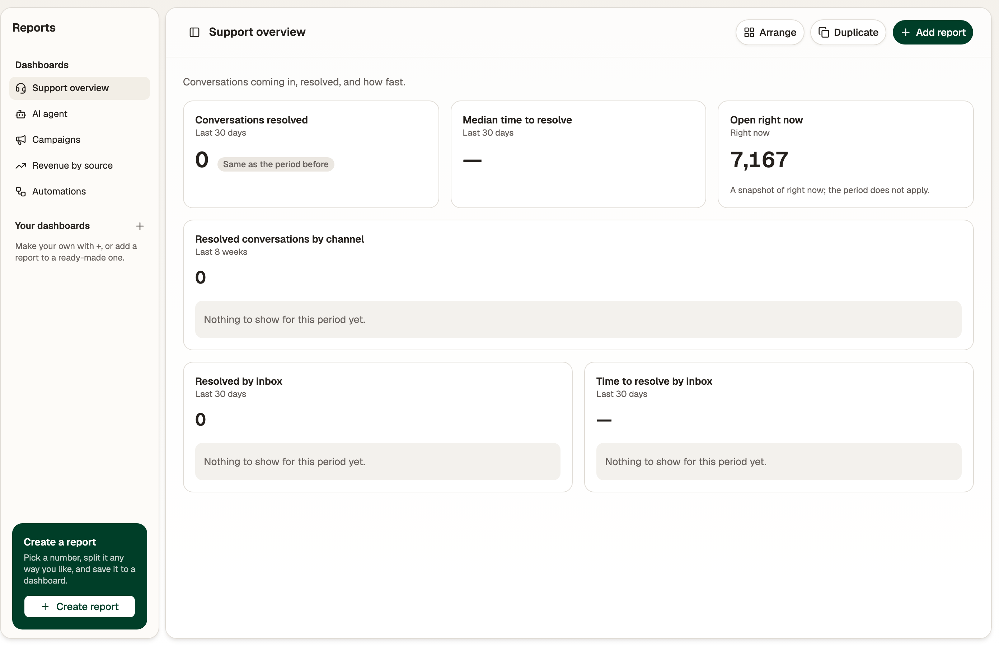
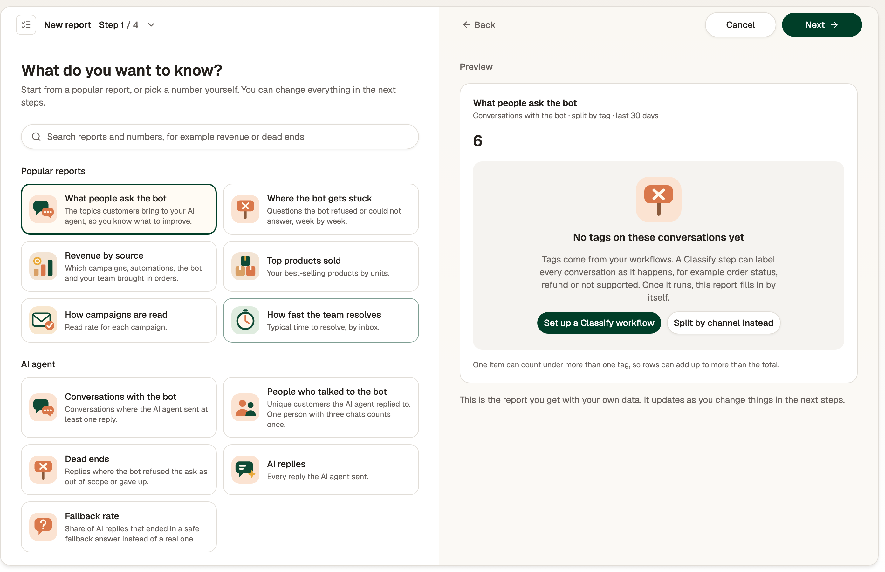

You see how your business is doing in Fufa: how fast your team answers, what your AI agent resolves, how campaigns are read, and where revenue comes from. Ready-made dashboards are there from the start, and you can build your own.

## Before you start

- Every role can see reports. To create and change them, you need the **Owner**, **Admin** or **Supervisor** role. Only **Owner** and **Admin** can delete them.

## Use the ready-made dashboards

Open **Reports**. Under **Dashboards**, every workspace has:

- **Support overview**: conversations resolved, median time to resolve, and what's open right now, by channel and inbox.
- **AI agent**: conversations and people the AI agent talked to, its dead ends, what people ask it, and the revenue it influenced.
- **Campaigns**: messages sent, read rate and click rate, by campaign, and why messages failed.
- **Revenue by source**: revenue, orders, average order value, influenced revenue by source, and top products.
- **Automations**: automation runs, failure rate and credits used.

Your own dashboards are listed under **Your dashboards**.

## Build a report

1. Select **New report**. The steps are **Pick a number**, **Shape it**, **How it looks** and **Save**.

   

2. **Pick a number**: under **What do you want to know?**, start from a popular report or choose a number, such as **Conversations opened**, **First response time**, **Resolved by the AI agent**, **Read rate**, **Orders** or **Influenced revenue**.
3. **Shape it**: choose **Split by**, for example by channel or agent, or **No split**. Under **Only include**, choose **Everything** or **Contacts in a segment**, and pick the **Period**. The preview updates as you go.
4. **How it looks**: choose how it's **Shown as**. Fufa picks the chart that fits your split, and switches off charts that would show it wrongly.
5. **Save**: enter a **Report name** and choose where to **Add to dashboard**. Saving to a ready-made dashboard makes your own copy of it. Choose **Who can see it**: **Everyone in the workspace** or **Only me**.
6. Select **Save report**. Fufa opens the dashboard with your report highlighted.

## Create a dashboard

1. Under **Your dashboards**, select **New dashboard**.
2. Enter a **Name**, such as *Monday review*, and click the emoji to pick its icon.
3. Under **Start from**, choose a ready-made dashboard or **Empty dashboard**.
4. Choose **Who can see it**, then create it.

On a dashboard, set each report's width to a third, half or the full row.

## Check it works

Open **Support overview**. It shows your conversations for the period you choose.

## Common questions

### What does Influenced revenue mean?

It's the revenue from paid orders placed within 7 days of a campaign, workflow, AI agent or teammate messaging the customer. It shows that the message influenced the order, not that it was the only reason.

### Can my teammates see my dashboards?

Only if you choose **Everyone in the workspace** under **Who can see it**. Dashboards set to **Only me** are visible only to you.

### Can I ask for a report without building it?

Yes. The same reports can be asked for in plain words from Claude or ChatGPT once they're connected to your Fufa workspace.

## Related

- [Catalog, orders and carts](/commerce/catalog/)
- [Send a WhatsApp campaign](/campaigns/send-a-campaign/)
- [Create an agent](/agents/create-an-agent/)
