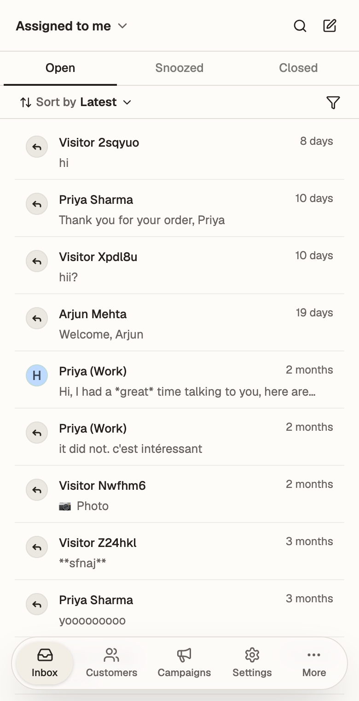

Fufa sits on your home screen and opens full screen, like any other app. You can answer customers on the go and get [notifications](/inbox/notifications/) when new messages arrive.

:::note
Fufa isn't in the App Store or Google Play. You install it from your phone's browser at [apps.fufa.ai](https://apps.fufa.ai), and it updates on its own.
:::

## Before you start

- A Fufa account. If you don't have one, [create a workspace](/start/create-a-workspace/) or accept your team's invitation first.
- On iPhone or iPad: Safari.
- On Android: Chrome.

## Install on iPhone or iPad

1. Open Safari and go to [apps.fufa.ai](https://apps.fufa.ai). Sign in.
2. Tap the **Share** button, the square with an arrow pointing up.
3. Scroll down and tap **Add to Home Screen**.
4. Keep the name **Fufa AI** and tap **Add**.

Open Fufa from the new icon on your home screen. On iPhone, the installed app keeps its own sign-in, separate from Safari's, so sign in once more there.

## Install on Android

1. Open Chrome and go to [apps.fufa.ai](https://apps.fufa.ai). Sign in.
2. Tap the **⋮** menu in the top-right corner.
3. Tap **Install app**. On some phones it's called **Add to Home screen**.
4. Tap **Install** to confirm.

Fufa appears on your home screen and in your app list. Touch and hold the icon for shortcuts to **Inbox** and **Campaigns**.

## Install on your computer

In Chrome or Edge, open [apps.fufa.ai](https://apps.fufa.ai) and select the install icon at the right of the address bar, then **Install**. Fufa opens in its own window and appears with your other apps.

## Check it works

Open Fufa from the home screen icon. It opens without the browser's address bar, and the tabs at the bottom show **Inbox**, **Contacts**, **Campaigns**, **Settings** and **More**. Then [turn on notifications](/inbox/notifications/) so new messages reach you.

## Common questions

### Is there a Fufa app in the App Store or Google Play?

No. Fufa installs from the browser instead, at apps.fufa.ai. Once it's on your home screen, it opens full screen like any other app and can send you notifications.

### Do I need to update the app?

No. Fufa updates itself. The next time you open it after a release, you get the newest version.

### I don't see Add to Home Screen on my iPhone. What now?

Make sure you're in Safari, not another browser or an app's built-in browser. Open apps.fufa.ai in Safari, tap **Share**, and scroll down the list of actions to find **Add to Home Screen**.

### Do I have to install Fufa to get notifications on my iPhone?

Yes. On iPhone and iPad, notifications work only once Fufa is on your home screen, on iOS 16.4 or later. Open Fufa from the home screen icon, then go to **Settings → Profile → Notifications** and select **Grant permissions**.

### How do I remove Fufa from my phone?

Remove it like any other app: touch and hold the icon, then choose to remove or uninstall it. Your workspace and conversations aren't affected.

## Related

- [Turn on notifications](/inbox/notifications/)
- [Find your way around Fufa](/start/tour/)
- [Reply from the inbox](/inbox/reply/)
