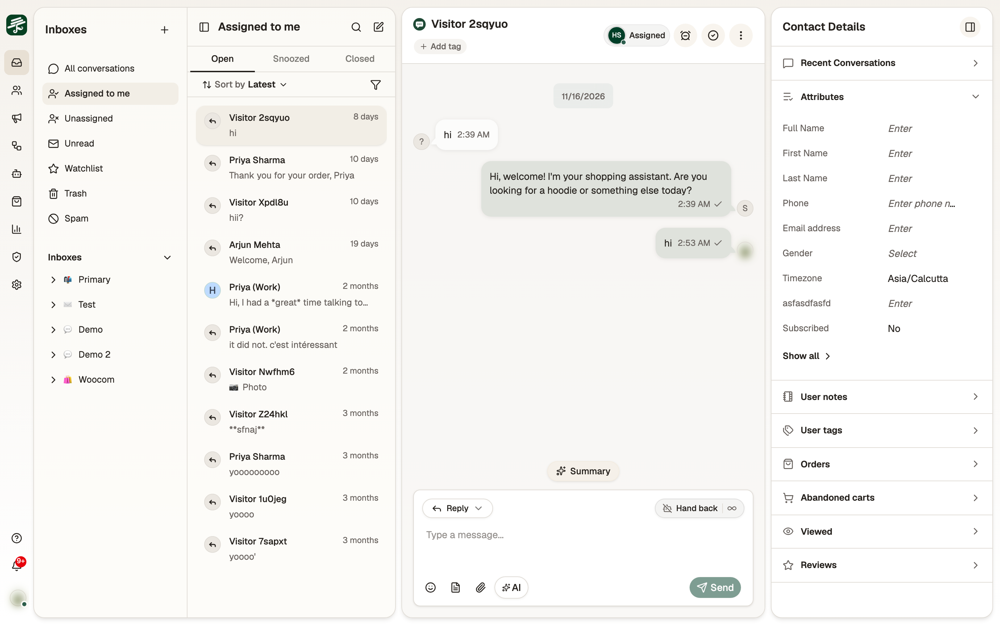
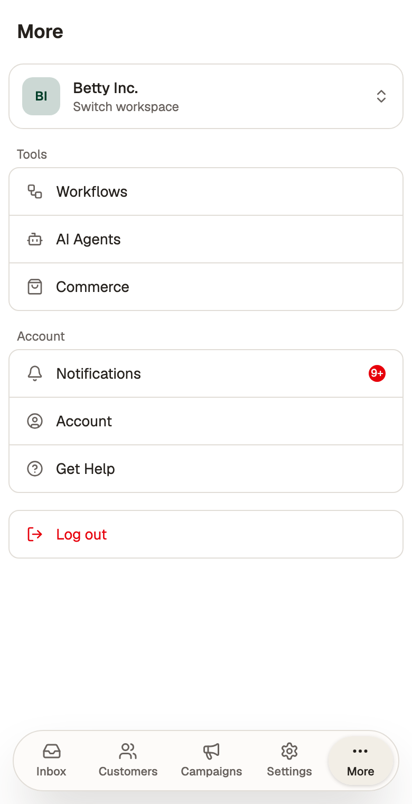

You know what each section of Fufa is for, where it sits in the app, and which page shows you how to use it. The sections are listed in the order they appear in the sidebar on the left.

## Before you start

- A Fufa workspace. See [Create a workspace](/start/create-a-workspace/).
- What you see depends on your role. A section you don't have access to is hidden from your sidebar.

## Inbox

Every conversation from every connected channel lands here: WhatsApp, live chat, Instagram, email, Telegram and phone. You reply, leave notes for your team, assign, snooze and close conversations, and take over from an AI agent.

The views on the left are **All conversations**, **Assigned to me**, **Unassigned**, **Unread**, **Watchlist**, **Trash** and **Spam**. **All conversations** appears only for roles that can see every conversation: **Owner**, **Admin** and **Supervisor**. The **Agent** role sees only the conversations assigned to them.

Start with [Reply from the inbox](/inbox/reply/) and [Views and assignment](/inbox/views-and-assignment/).

## Contacts

Everyone who has messaged you, or that you've imported, with their conversations, tags and attributes. In a store workspace, this section is called **Customers**.

- **All Contacts** lists everyone.
- **Subscribers** lists the contacts who have opted in to marketing messages.
- **Imports** shows each CSV import you've run.
- Your segments are listed below them. Select **Create Segment** to add one.

See [Manage contacts](/contacts/contacts/) and [Group contacts into segments](/contacts/segments/).

## Campaigns

Message many customers at once.

- **WhatsApp** sends a campaign with an approved template to a list or segment.
- **Web** shows a campaign on your website.
- **Opt-in methods → Popups** collects opt-ins on your site.

The **Supervisor** role doesn't see Campaigns. See [Send a WhatsApp campaign](/campaigns/send-a-campaign/).

## Workflows

Automations that run steps on their own, such as following up on an abandoned cart or confirming a cash-on-delivery order.

- **Pre-built** holds ready-made automations you switch on.
- **Custom** holds the workflows you build yourself on a canvas.
- **All Runs** shows every run and what happened at each step.

See [How workflows run](/workflows/how-workflows-run/).

## AI Agents

Your AI agents, each with its own instructions, knowledge, tools and channels. Agents answer customers and hand conversations to your team when they can't help. See [Create an agent](/agents/create-an-agent/).

## Commerce

Your connected store's **Catalog**, **Orders** and **Abandoned Carts**. Commerce appears only in workspaces set up for an online store. Connect a store first, from **Settings → Ecommerce**. See [Connect Shopify](/commerce/shopify/).

## Reports

Charts about conversations, agents, campaigns and sales. You build reports and pin them to dashboards. See [Build reports and dashboards](/reports/reports-and-dashboards/).

## Settings

Everything you set up once, grouped into sections:

- **Account**: your **Profile** and **Notifications**.
- **Workspace**: **Workspace** details and **Brand kit**, **Inboxes**, **Team** and **Billing**.
- **Data**: **Tags**, **Segments**, **Attributes** and **Reviews**.
- **Connect**: **Integrations**, **Data Connectors** and **Ecommerce**.
- **Templates**: **WhatsApp Templates**, **Email templates** and **Canned Responses**.

## On your phone

On a phone, the tabs at the bottom are **Inbox**, **Contacts** (or **Customers**), **Campaigns**, **Settings** and **More**. **More** holds **Workflows**, **AI Agents**, **Commerce**, your **Notifications** and **Account**. To get Fufa on your home screen, see [Install Fufa on your phone](/start/install-on-your-phone/).

## Common questions

### Why can't I see a section that my teammate can?

Your role hides it. Each section is shown only to roles that can use it. For example, the **Agent** role doesn't see **Billing**, and the **Supervisor** role doesn't see **Campaigns**. Ask an **Owner** or **Admin** to change your role in **Settings → Team**.

### Why don't I see Commerce?

Commerce appears only in workspaces set up for an online store. Workspaces for other kinds of business don't have it, and they show **Contacts** instead of **Customers**.

### Does Fufa have modules I need to switch on?

No. Every section is available as soon as your workspace is created. What you see depends only on your role and on whether your workspace is set up for an online store.

## Related

- [Install Fufa on your phone](/start/install-on-your-phone/)
- [Reply from the inbox](/inbox/reply/)
- [Roles and permissions](/workspace/roles/)
