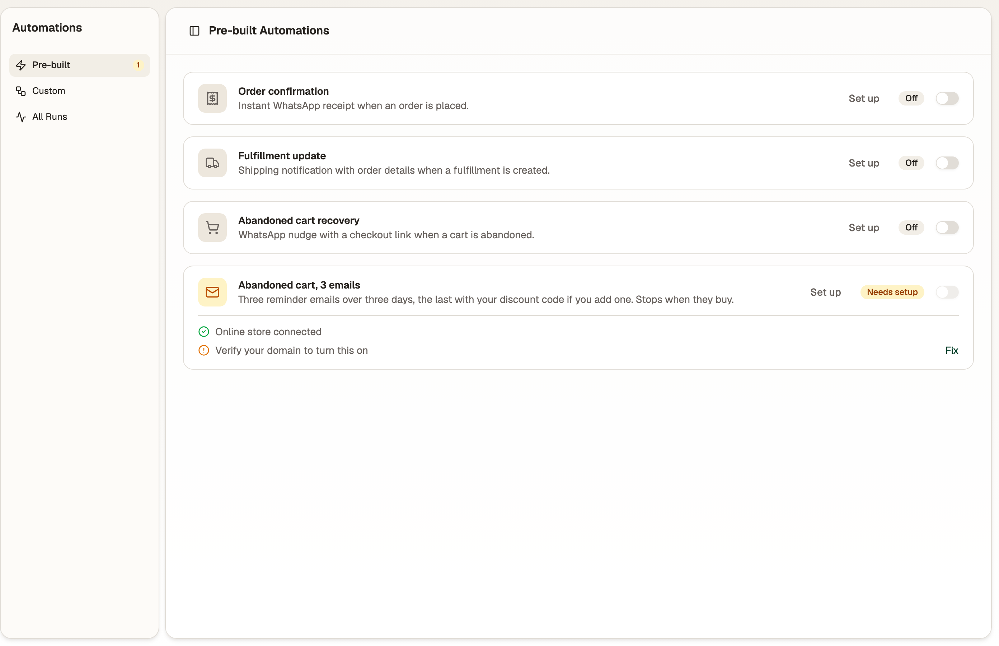

Your store sends the messages every customer expects, without you building anything: an order receipt, a shipping update and abandoned cart reminders. Each automation is ready-made. You choose the channel and store, and switch it on.

## Before you start

- You need the **Owner**, **Admin** or **Supervisor** role.
- A [connected store](/commerce/shopify/), because these automations start from orders and carts.
- For WhatsApp automations, a [connected WhatsApp number](/channels/whatsapp/). For the email automation, an [email channel](/channels/email/) on your own verified domain.

## The automations

| Automation | What it sends |
| --- | --- |
| **Order confirmation** | An instant WhatsApp receipt when an order is placed. |
| **Fulfillment update** | A WhatsApp shipping notification with order details when a fulfillment is created. |
| **Abandoned cart recovery** | A WhatsApp nudge with a checkout link when a cart is abandoned. |
| **Abandoned cart, 3 emails** | Three reminder emails over three days, the last with your discount code if you add one. Stops when they buy. |

## Turn one on

1. Open **Workflows → Pre-built**.
2. On the automation, select **Set up**.
3. Choose the **WhatsApp channel**, or for the email automation, the email channel to **Send from**.
4. Optionally choose a **Store**. Leave it empty to run for all your stores.
5. For **Abandoned cart, 3 emails**, optionally enter a **Discount code** to show in the last email. Create the code in your store first.
6. Select **Save and turn on**.

Fufa provides the message templates. A WhatsApp template has to be approved by Meta first, so the automation shows **Waiting approval** and turns on by itself once Meta approves it. Then it shows **Active**.

To change the settings later, select **Configure**. To stop an automation, turn off its switch.

## The abandoned cart emails

**Abandoned cart, 3 emails** waits an hour after the cart is abandoned, then sends the first email. The second goes a day later and the third two days after that. Before each email, Fufa checks that the cart is still abandoned, and stops if the customer has bought. You can change the three emails in [email templates](/campaigns/email-templates/).

## Check it works

Place a test order in your store with your own phone number. The order confirmation arrives on WhatsApp within a minute. Each automation's card shows how many messages were **Sent**, **Delivered** and **Read**.

## Common questions

### Why does my automation say Needs setup?

It hasn't been set up yet, or a channel or template it needs is missing. Select **Configure**, check the channel and store, and select **Save**.

### Can I change the WhatsApp message?

The automation uses a ready-made template from Fufa's library. For a different message, [build a custom workflow](/workflows/create-a-workflow/) with the **Order created**, **Order fulfilled** or **Cart abandoned** trigger and your own template.

### Will customers get both the WhatsApp and the email cart reminders?

Yes, if you turn on both. They're separate automations. Turn on the one that fits your customers, or both if you want reminders on two channels.

## Related

- [How workflows run](/workflows/how-workflows-run/)
- [Design email templates](/campaigns/email-templates/)
- [Catalog, orders and carts](/commerce/catalog/)
