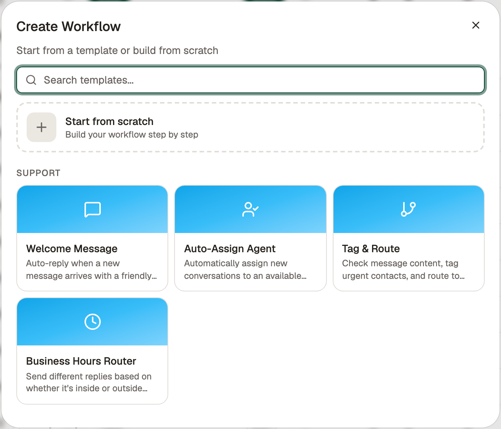

You have your own automation, built step by step on a canvas. For example: when a customer asks about wholesale, tag them, assign the conversation to your sales lead, and send a WhatsApp template.

## Before you start

- You need the **Owner**, **Admin** or **Supervisor** role.
- The channels, templates and tags your workflow will use, such as an approved [WhatsApp template](/campaigns/whatsapp-templates/).

## Create the workflow

1. Open **Workflows → Custom** and select **New workflow**.
2. In **Create Workflow**, pick a template, filtering by **Support**, **Marketing**, **Ecommerce** or **General**, or choose **Start from scratch**.
3. Enter a **Name**, such as *Wholesale enquiries*, and an optional description. Select **Create**.

   

The workflow opens on the canvas as a draft.

## Build it on the canvas

1. **Pick the trigger.** In **Select Trigger**, choose what starts a run, from **Built-in** or **Ecommerce**. For example, **Message received**, **Contact created**, **Order created** or **Cart abandoned**. Set its options, such as which channels or store it listens to.
2. **Add steps.** Select the **+** after a step and search for the node you need: an action such as **Send email** or **Add contact tag**, a condition such as **If else** or **Check tag**, or a **Delay**.
3. **Set each step.** Select a step to open its settings. Insert details from the contact, conversation or order with variables. For an HTTP request, select **Send test request** to try it.
4. **Branch.** A condition has a path for each outcome. Add the next steps on each path.

Use the controls at the bottom of the canvas to **Undo**, **Redo**, **Search Nodes**, **Tidy Layout** or **Fit to View**. To rename a step, select **Edit label** on it.

## Publish it

1. Select **Publish**. If another workflow or agent already replies on the same channels, Fufa lists the overlaps first. Select **Publish anyway** or **Cancel** to change it.
2. Fufa shows **Workflow published successfully**. New runs start the next time the trigger happens.

After you change a published workflow, select **Update** to put your changes live. To stop it, select **Pause**. From the workflow menu you can also **Duplicate**, **Save as Template** for your team, or **Delete** it. **Version** lists earlier published versions. When you're viewing one, **Back to Draft** returns you to the version you're editing.

## Check it works

Make the trigger happen, for example send a message containing *wholesale* from your own phone. Open **Workflows → All Runs** and select **View execution graph** on the newest run to see each step it took.

## Common questions

### Can a workflow send a WhatsApp message to a customer who hasn't written in 24 hours?

Only with an approved template. Use the WhatsApp template action. Free-form WhatsApp messages only go out within 24 hours of the customer's last message.

### Can a workflow hand a conversation to an AI agent?

Yes. Add the AI agent step and choose the agent. Agents you turn on from an agent's **Deploy** page also run as workflows, marked **Managed on the agent's Deploy page**. Change those from the agent, not the canvas.

### How do I use Google Sheets in a workflow?

Connect Google Sheets first in **Settings → Integrations**. Its actions to get rows from a sheet and append a row then appear when you add a step. See [Connect your tools](/workspace/integrations/).

## Related

- [How workflows run](/workflows/how-workflows-run/)
- [Turn on pre-built automations](/workflows/automations/)
- [Connect your tools](/workspace/integrations/)
