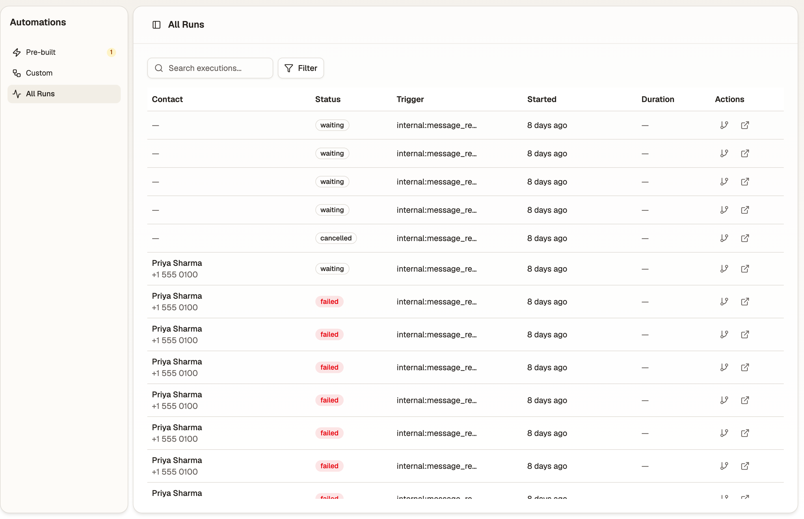

You know what makes a workflow start, what it does at each step, and where to see what happened on every run. Workflows do repetitive work on their own, such as confirming orders or following up on abandoned carts.

## Before you start

- Every role can see workflows and their runs. To create and change them, you need the **Owner**, **Admin** or **Supervisor** role. Only **Owner** and **Admin** can delete them.

## Two kinds of workflow

Open **Workflows**. Its sidebar has:

- **Pre-built**: ready-made automations you set up with a few choices and switch on. See [Turn on pre-built automations](/workflows/automations/).
- **Custom**: workflows you build yourself on a canvas. See [Build a custom workflow](/workflows/create-a-workflow/).
- **All Runs**: every run of every workflow.

## How a run moves

Every workflow starts with one **trigger**, the event that starts a run. For example, a customer sends a message, a contact is created, an order is placed or fulfilled, or a cart is abandoned. Each time the event happens, a new run starts for that contact.

From the trigger, the run follows the steps you've connected, one after another:

- **Actions** do something: send a WhatsApp template, an email or a message, add a tag, assign or close the conversation, update the contact, call an HTTP endpoint, or hand over to an AI agent.
- **Conditions** choose a path: by tag, attribute, segment, inbox, assignee, time of day, order details, or what the customer's message says.
- **Waits** pause the run, for example for an hour or two days, then continue.

A run ends when it reaches the last step, when a condition sends it down a path with no more steps, or when it's cancelled.

## Follow a run

1. Open **Workflows → All Runs**. Each run shows its **Contact**, **Status**, **Trigger**, when it **Started** and its **Duration**.

   

2. Select **View execution graph** on a run. The canvas shows the path the run took.
3. Select any step to see when it **Started** and **Completed**, its **Duration**, its **Attempts**, and the **Input** and **Output** data.

To go from a run to the workflow itself, select **Open workflow**.

## Check it works

Make the trigger happen yourself, for example send a message to one of your channels from your own phone. A new run appears at the top of **All Runs**.

## Common questions

### Why didn't my workflow run?

Check three things. The workflow is published, not paused. Its trigger matches what happened, including any channel or store it's limited to. And the run didn't stop at a condition: open **All Runs** and look at the last step it reached.

### Does a workflow run more than once for the same customer?

Yes, by default it runs each time the trigger happens. Some triggers can be limited to once per contact, with a waiting period before they can run again for that contact.

### Do workflows and AI agents conflict?

They can, if both reply to the same messages. When you publish a workflow that replies to messages on a channel where another workflow or agent replies too, Fufa warns you before it goes live. Limit one of them to other channels, or pause one.

## Related

- [Turn on pre-built automations](/workflows/automations/)
- [Build a custom workflow](/workflows/create-a-workflow/)
- [Create an agent](/agents/create-an-agent/)
