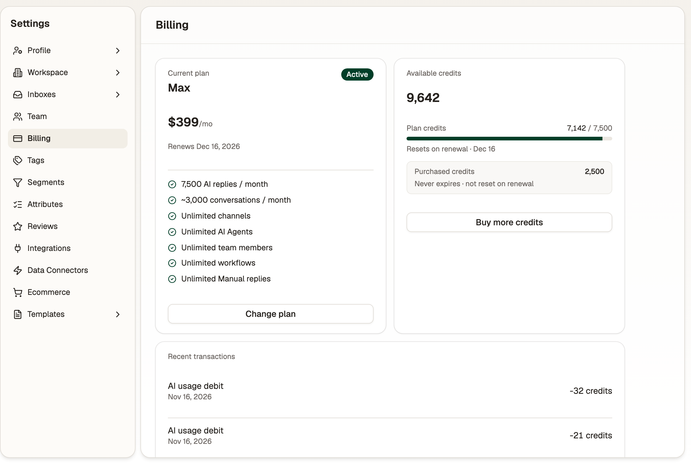

You're on the plan that fits your business, and you know how many credits you have left. Credits pay for the AI work in Fufa, such as AI agent replies and voice calls.

## Before you start

- To change the plan or buy credits, you need the **Owner** or **Admin** role. The **Supervisor** role can view billing, and the **Agent** role doesn't see it.

## See your plan and credits

Go to **Settings → Billing**. It shows:

- Your **Current plan**, and when it **Renews**, or **Cancels** if you've cancelled.
- **Available credits**, split into **Plan credits**, which come with your plan and reset on renewal, and **Purchased credits**, which never expire and aren't reset on renewal.
- **Recent transactions**: plan renewal grants, credit purchases and usage, such as **AI usage debit** and **Voice call debit**.

## Change your plan

1. In **Settings → Billing**, select **Change plan**.
2. Compare the plans and select **Choose** on the one you want.
3. Confirm. Fufa shows **Plan updated**.

The new credit allowance applies right away. A price change takes effect on your next billing date.

## Buy credits

1. In **Settings → Billing**, select **Buy more credits**.
2. In **Buy credits**, choose an amount and select **Buy** to confirm.

The charge goes to your payment method on file. Credits appear once the payment is confirmed, and purchased credits never expire.

If your workspace is billed through the Shopify App Store, credits come with your plan, and **Buy more credits** isn't shown.

## Check it works

After a purchase, **Purchased credits** in **Settings → Billing** goes up, and a **Credit purchase** appears in **Recent transactions**.

## Common questions

### What happens when I run out of credits?

AI replies and voice calls pause when credits reach zero. Your team can still reply from the inbox. Fufa shows **You're running low on credits** and **Almost out of credits** before that happens. Buy more credits, or wait for your plan to renew.

### Do unused credits roll over?

Plan credits reset each billing cycle. Purchased credits never expire and stay in your balance until you use them.

### Do AI agents count as seats?

No. Seats are teammates who sign in to Fufa. AI agents don't use seats.

### Can I change my plan later?

Yes. Upgrade or downgrade any time from **Settings → Billing**. The new credit allowance applies immediately, and price changes take effect on your next billing date.

## Related

- [Invite your team](/workspace/team/)
- [Roles and permissions](/workspace/roles/)
- [Create an agent](/agents/create-an-agent/)
