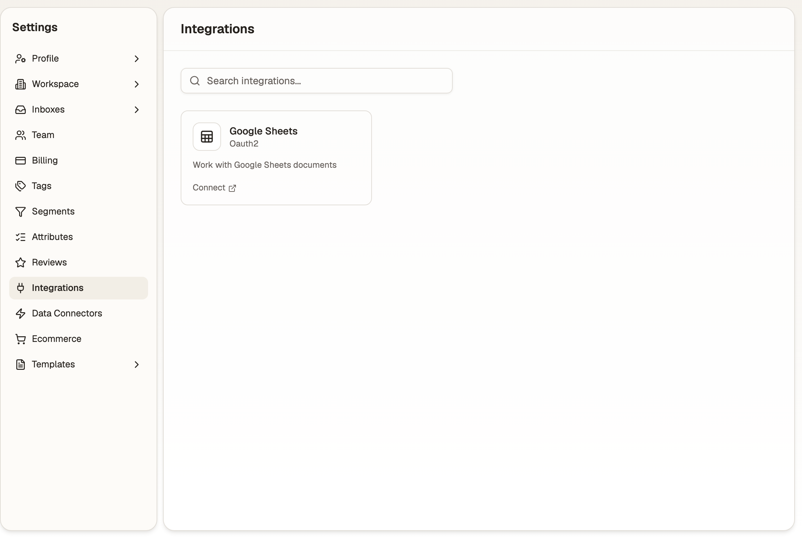

Your Fufa workflows can read from and write to your other tools. For example, a workflow can add a row to a Google Sheet for every new lead, or look up a customer's details in a sheet before replying.

## Before you start

- Every role can see integrations.
- A Google account with access to the sheets you want to use.

## Connect Google Sheets

1. Go to **Settings → Integrations**.
2. On **Google Sheets**, select **Connect**.
3. Sign in with Google and allow Fufa to access your sheets.

   

The integration shows as **Connected**. To add another Google account, open the integration and select **Add connection**.

## Use it in a workflow

Open a [custom workflow](/workflows/create-a-workflow/) and add a step. The Google Sheets actions appear:

- Get rows: fetches rows from a sheet using filters.
- Append row: adds a new row to the end of a sheet, with the values you map to each column.

## Check it works

Build a short workflow that appends a row, trigger it, and open the sheet. The new row is at the bottom.

## Common questions

### How do I disconnect an integration?

Open it in **Settings → Integrations**, select **Manage**, and remove the connection. Confirm under **Disconnect integration?** Workflows that use it stop being able to reach the sheet.

### Can my AI agent use Google Sheets?

Not through this integration. Integrations are used by workflows. To let an agent call your own systems, add a [connector](/agents/connectors/).

### Where is Shopify?

Stores are connected under **Settings → Ecommerce**, not here. See [Connect Shopify](/commerce/shopify/).

## Related

- [Build a custom workflow](/workflows/create-a-workflow/)
- [Connect your own APIs to an agent](/agents/connectors/)
- [Connect Shopify](/commerce/shopify/)
