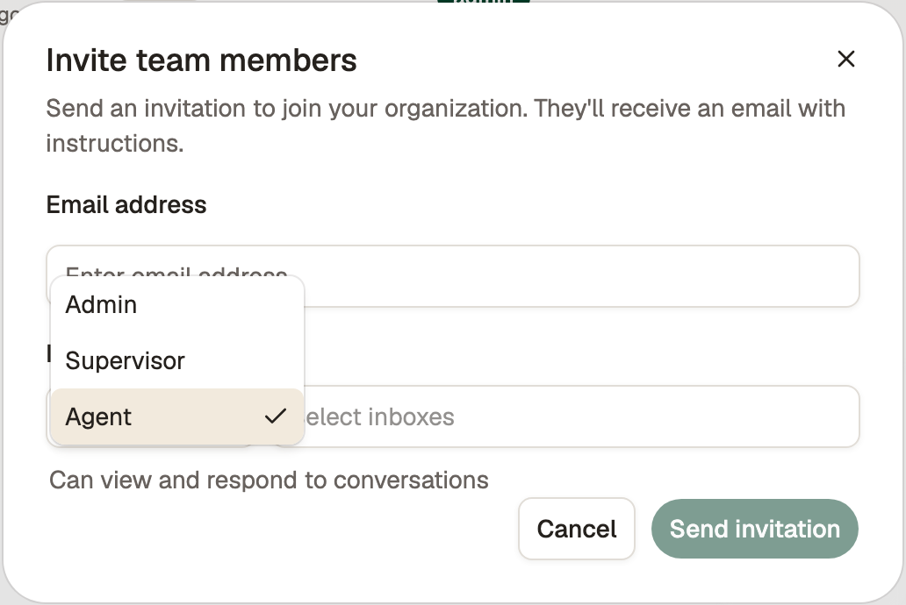

You know what each role can do before you give it to a teammate. Every person in a workspace has one role. A section of Fufa that a role can't use is hidden from that person's sidebar.

## Before you start

- To change someone's role, you need the **Owner** or **Admin** role. See [Invite your team](/workspace/team/#change-a-role-or-inbox-access).

## The four roles

- **Owner**: the person who created the workspace. Can do everything. The owner role can't be changed.
- **Admin**: can do everything the Owner can in day-to-day use, including billing, channels and the team.
- **Supervisor**: runs the team and the automation. Sees every conversation, shapes agents and workflows, but doesn't send campaigns or manage billing.
- **Agent**: answers the customers whose conversations are assigned to them.

## What each role can do

**Full** means view, create, change and delete. **Edit** means view, create and change, but not delete. **View** means view only.

| Area | Owner | Admin | Supervisor | Agent |
| --- | --- | --- | --- | --- |
| Conversations | Full, every conversation | Full, every conversation | Edit, every conversation | Edit, only those assigned to them |
| Inboxes | Full | Full | Edit | View |
| Channels | Full | Full | View and change | View |
| Contacts | Full | Full | Edit | Edit |
| Tags | Full | Full | Full | View and create |
| Attributes | Full | Full | View | View |
| Segments | Full | Full | Edit | View |
| Canned responses | Full | Full | Edit | View |
| Email templates and brand kit | Full | Full | Edit | View |
| Campaigns and web campaigns | Full | Full | No access | View |
| Opt-in popups | Full | Full | Full* | View |
| AI agents | Full | Full | Edit | View and create |
| Agent knowledge | Full | Full | Edit | View |
| Data connectors | Full | Full | Full | View |
| Workflows | Full | Full | Edit | View |
| Reports | Full | Full | Edit | View |
| Commerce | View | View | View | View |
| Billing | Full | Full | View | No access |
| Team | Full | Full | View | View |

Commerce is view-only for everyone, because products and orders are changed in your store.

\* Popups live under **Campaigns**, which the Supervisor role doesn't see, so Supervisors can't reach the popups page in the app.

## Check it works

Ask a teammate to sign in after you change their role. Their sidebar shows only the sections their new role can use.

## Common questions

### Which role should I give my support staff?

**Agent**, for people who only answer customers. They see the conversations assigned to them, and can reply, tag and update contacts. Give **Supervisor** to team leads who also see every conversation, assign work, and shape agents and workflows.

### Why can't a Supervisor see Campaigns?

The Supervisor role doesn't include campaigns, so the section is hidden. Campaigns message many customers at once and cost money with Meta, so only **Owner** and **Admin** send them.

### What's the difference between Owner and Admin?

In daily use, none. The Owner is the person who created the workspace, and their role can't be changed or removed. Give **Admin** to anyone else who needs full access.

### Which conversations can an Agent see?

Only the conversations assigned to them, in the inboxes they've been given under **Inbox access settings** in **Settings → Team**. To give an Agent a conversation, an **Owner**, **Admin** or **Supervisor** assigns it to them.

## Related

- [Invite your team](/workspace/team/)
- [Find your way around Fufa](/start/tour/)
- [Billing and credits](/workspace/billing/)
