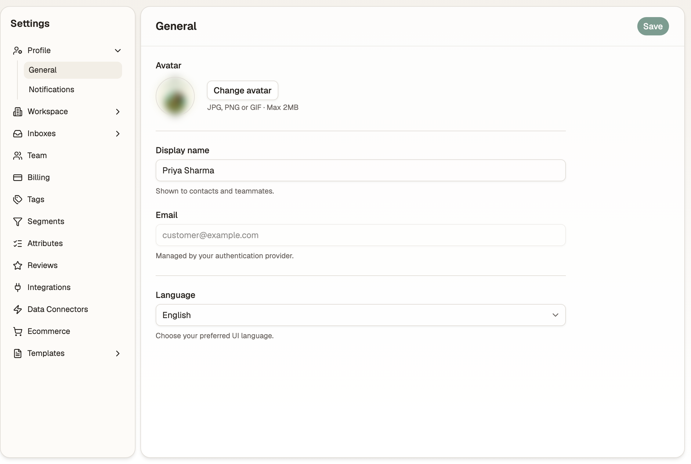
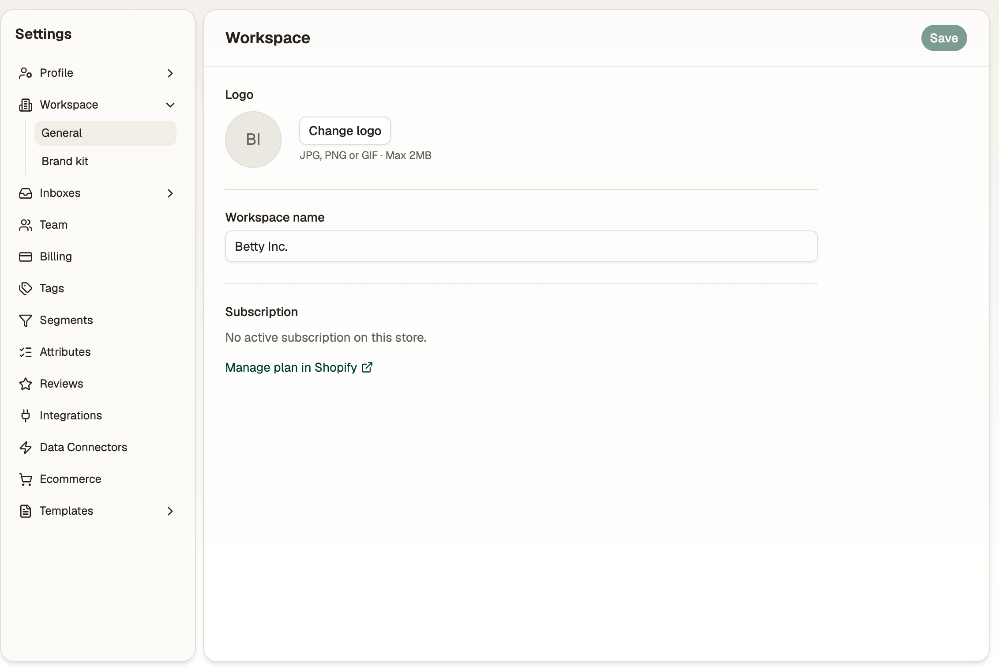
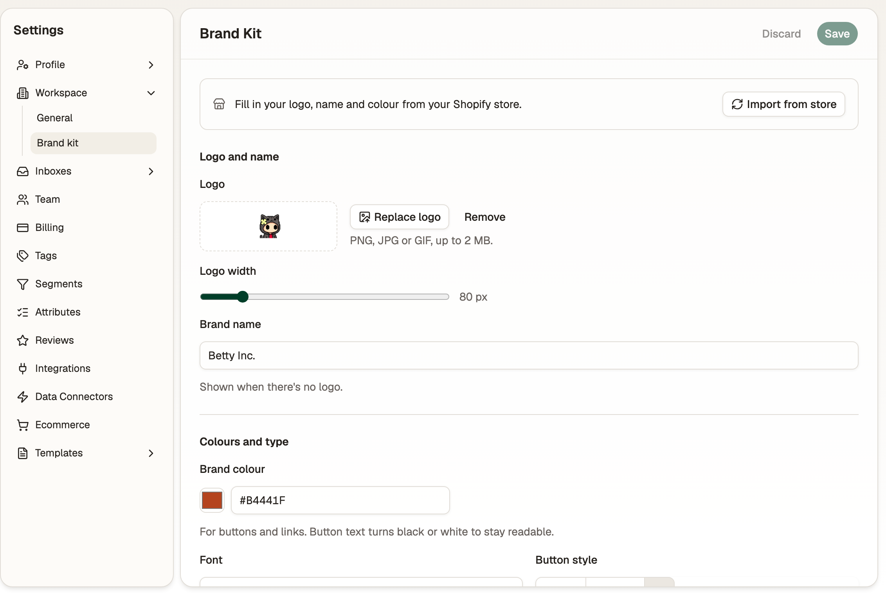

Your profile, your workspace and your emails look the way you want. Customers and teammates see your name and photo, and every email Fufa sends carries your brand.

## Before you start

- Anyone can change their own profile.
- To change the workspace name and logo, you need the **Owner** or **Admin** role.
- To change the brand kit, you need the **Owner**, **Admin** or **Supervisor** role.

## Update your profile

1. Go to **Settings → Profile → General**.
2. Select **Change avatar** to upload a photo. JPG, PNG or GIF, up to 2 MB.
3. Change your **Display name**. It's shown to contacts and teammates.
4. Choose your **Language** for the Fufa app: **English**, **Deutsch** or **हिन्दी**.
5. Select **Save**.

   

Your **Email** is the address you sign in with, so it can't be changed here.

## Update the workspace

1. Go to **Settings → Workspace → General**.
2. Select **Change logo** to upload your logo, and change the **Workspace name**.
3. Select **Save**. Fufa shows **Workspace updated**.

   

## Set up your brand kit

Every [email template](/campaigns/email-templates/) takes its header, colours and footer from the brand kit.

1. Go to **Settings → Workspace → Brand kit**.
2. If your store is connected, select **Import from store** to fill in your logo, name and colour from it.

   

3. Under **Logo and name**, upload a **Logo** (PNG, JPG or GIF up to 2 MB), set the **Logo width**, and enter a **Brand name**, which is shown when there's no logo.
4. Under **Colours and type**, choose your **Brand colour** for buttons and links, a **Font**, and a **Button style**: **Square**, **Rounded** or **Pill**.
5. Under **Footer**, enter your **Business address**, which email law requires in most countries, and any **Social links**.
6. Select **Save**. The **Sample email** beside the form shows the result as you go.

An unsubscribe link is always added to every email.

## Check it works

Open any email template and select **Send test to me**. The email arrives with your logo, colour, font and footer.

## Common questions

### Can I change the email address I sign in with?

Not from your profile. Your email is managed by your sign-in, whether that's an email code or Google. To use a different address, ask an **Owner** or **Admin** to invite it to the workspace.

### Why is Fufa showing in a different language?

Each person picks their own language. Go to **Settings → Profile → General**, choose your **Language** and select **Save**.

### Which font should I choose for emails?

**Helvetica** and **Georgia** show the same in every mail app. **Inter**, **Lora** and **Poppins** look more distinctive, but some mail apps replace them with a standard font.

## Related

- [Design email templates](/campaigns/email-templates/)
- [Invite your team](/workspace/team/)
- [Turn on notifications](/inbox/notifications/)
